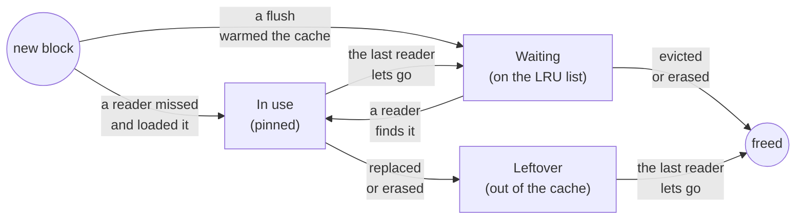
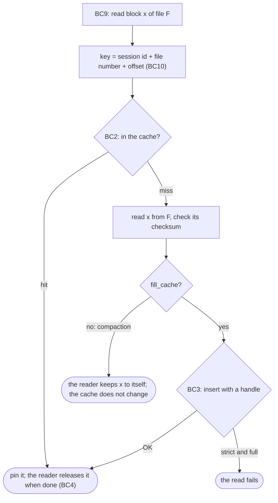

# The Block Cache

## Reference

- [RocksDB wiki: Block Cache](https://github.com/facebook/rocksdb/wiki/Block-Cache)

## Problem

A key–value store built as an LSM tree keeps new writes in memory, in a sorted buffer called a
**memtable**. When a memtable is full, a **flush** writes it to disk as an **SST file**. SST files
never change after they are written. Over time, **compaction** reads several SST files, merges
them, writes new files, and deletes the old ones.

An SST file is a sequence of **blocks** of a few kilobytes each:

- **data blocks** hold the sorted key–value pairs;
- the **index block** says which data block holds a key;
- the **filter block** (a Bloom filter) says whether a key can be in the file at all.

Reading one key from one file means reading its filter, its index, and one data block. Reading from
disk is slow. The **block cache** keeps recently read blocks in memory, so that the next read of the
same block needs no I/O.

The cache has a fixed **capacity**, in bytes. Each block counts its size, its **charge**, against
it. When a new block does not fit, the cache frees the block that was used least recently (LRU).
A block that a reader is using right now is **pinned**: it cannot be freed until the reader lets
go. One cache can be shared by every column family of many stores in one process, so they all
share one memory budget.

## How it fits with the rest of the store 
The cache sits on the read side. Nothing in the write path uses it, except one module:

- **Reads** (MT7 for a point read, CF5 for iterators) read SST blocks through the cache. A hit
  costs no I/O. A miss reads the block from the file and puts it in the cache.
- **Compaction** reads every block of its input files once, merges them, and writes new files. It
  uses a block that is already cached, but it does not put new blocks in the cache.
- **Flush** (MT5) writes a new SST file. It may put the new file's blocks in the cache, so the first
  reads after the flush hit.
- **When compaction finishes**, its input files are obsolete. Their readers close and let go of
  any blocks they pinned. Their blocks may also be erased from the cache at once.
- The **write buffer manager** limits the memory of all memtables. It can charge that memory to the
  block cache by inserting empty "dummy" entries, which it keeps pinned. Memtables and cached
  blocks then share one budget.

The earlier specifications use contracts K1 to K7 between modules. The cache relies on three more,
which the table readers and the LSM tree keep:

- **(K8)** A cache key names one block of one SST file for the life of the cache. Files never
  change, and a key is never used for other content.
- **(K9)** Every pin is released exactly once, by the reader that holds it. A table reader releases
  its pins when it closes.
- **(K10)** Compaction reads with `fill_cache = false`: a miss does not insert the block.

## State

The cache is split into **shards**, chosen by the top bits of a hash of the key. By default each
shard has at least 512 KB, and there are at most 64. Shards share nothing. Each shard keeps:

- **C**, its capacity: an equal share of the total;
- **U**, its usage: the charge of every entry that exists, pinned or not;
- **T**, a hash table from key to entry;
- **L**, the LRU list, oldest first. It holds the entries that are in T and not pinned. It has two
  parts: the low-priority part, and the **high-priority pool**. The pool may hold up to a share ρ
  of C (`high_pri_pool_ratio`). Its usage is **H**;
- `strict`, whether an insert may take the shard over C (`strict_capacity_limit`).

Each entry has a key, a value (the block), a charge, and a reference count `refs`: the number of
pins. It also has flags: in T or not, inserted with high priority, looked up at least once (hit),
and in the pool.

## The Life of a Cache Entry

A block in the cache is always in one of three states:

- **In use.** At least one reader holds it. It is pinned, so it cannot be evicted.
- **Waiting.** Nobody holds it. It sits on the LRU list, and eviction may free it.
- **Leftover.** It was removed from the cache, but a reader still holds it. It is freed when that
  reader lets go.

If the shard is over capacity when the last reader lets go, the block is freed at once instead of going back to waiting.

Only waiting blocks are on the LRU list, and eviction only takes from that list. So a block that someone is using can never be freed under them.

## The LRU List

New data blocks go to the newest end of the low-priority part. Index and filter blocks can be
inserted with high priority (`cache_index_and_filter_blocks_with_high_priority`), and any block that
was looked up at least once returns to the list with high priority. Those go to the newest end of
the pool. When the pool is over its share, its oldest entries spill into the low-priority part,
where they compete with data blocks again.

Eviction takes the oldest entry of the low-priority part first, then the oldest entry of the pool.
It stops when the new block fits, or when the list is empty. If the list is empty and the block
still does not fit, everything left is pinned. Then:

- an insert **without** a handle (nobody would hold it) is dropped, and the call succeeds;
- an insert **with** a handle fails if the cache is strict, and the read that wanted the block
  fails too;
- otherwise the insert goes ahead, and the shard goes over its capacity. The extra memory is
  pinned. When the last pin on such an entry is released while the shard is still over capacity,
  the entry is erased instead of going back on the list.

## The LRU List

New data blocks go to the newest end of the low-priority part. Index and filter blocks can be
inserted with high priority (`cache_index_and_filter_blocks_with_high_priority`), and any block that
was looked up at least once returns to the list with high priority. Those go to the newest end of
the pool. When the pool is over its share, its oldest entries spill into the low-priority part,
where they compete with data blocks again.

Eviction takes the oldest entry of the low-priority part first, then the oldest entry of the pool.
It stops when the new block fits, or when the list is empty. If the list is empty and the block
still does not fit, everything left is pinned. Then:

- an insert **without** a handle (nobody would hold it) is dropped, and the call succeeds;
- an insert **with** a handle fails if the cache is strict, and the read that wanted the block
  fails too;
- otherwise the insert goes ahead, and the shard goes over its capacity. The extra memory is
  pinned. When the last pin on such an entry is released while the shard is still over capacity,
  the entry is erased instead of going back on the list.

## Reads, Compaction, and a File's Life

**Cache keys.** A key must name one block and nothing else, for as long as the cache lives. A file
number alone is not enough. Two stores that share a cache both have a file 7. A store that crashes
may write file 7 again after it recovers. RocksDB puts a session id in the key, and every open
starts a new session.

**Index and filter blocks.** By default they live in the table reader, outside the cache. With
`cache_index_and_filter_blocks` they go through the cache like data blocks. With
`pin_l0_filter_and_index_blocks_in_cache` too, the reader of an L0 file pins them for as long as it
is open.

**Flush.** With `prepopulate_block_cache = kFlushOnly`, a flush inserts the data blocks of its new
file, without pins. Compaction outputs are never inserted.

**Obsolete files.** When compaction finishes, its inputs are obsolete. Their readers close and
release their pins. Their blocks can no longer be looked up, because no reader of the file is left
and the keys are never used again. They stay in the cache until eviction takes them, unless
`uncache_aggressiveness` is set. Then they are erased at once.

## Algorithms
| Algorithm | Procedure | What it does |
|---|---|---|
| BC1 | `NewLRUCache`, `Shard(k)` | Splits the cache into shards, each with an equal share of the capacity |
| BC2 | `S.Lookup(k)` | Finds a block, pins it, and takes it off the LRU list |
| BC3 | `S.Insert(k, v, c, p, handle)` | Evicts, then adds a block; refuses or drops it if it cannot fit; detaches a pinned entry it replaces |
| BC4 | `S.Release(e, eraseIfLastRef)` | Unpins; at the last release, puts the entry back on the list or erases it |
| BC5 | `S.Erase(k)`, `S.EraseUnRefEntries()` | Removes a block now, or at its last release if pinned |
| BC6 | `S.LruInsert`, `S.LruRemove`, `S.MaintainPoolSize` | The two-part LRU list and the pool's spill |
| BC7 | `S.EvictFromLRU(c)` | Frees the oldest unpinned blocks until `c` more fits |
| BC8 | `SetCapacity`, `SetStrictCapacityLimit` | Changes the options at run time |
| BC9 | `RetrieveBlock(F, x, o)` | Reads a block through the cache; with `fill_cache = false`, never inserts |
| BC10 | `CacheKey(F, x)` | Builds a key from the session id, the file number, and the offset |
| BC11 | `OpenTable`, `OnFlushOutput`, `OnObsolete` | Pins L0 index and filter blocks; warms the cache after a flush; unpins and uncaches obsolete files |

## Invariants

Compaction reads every block of its inputs, holds each block
while it merges it, creates files, and makes files obsolete. The properties that matter to it are: 

- **CH2, pin safety.** A pinned block is never freed. Compaction merges a block while other threads
  insert blocks and evict others. If eviction could free the block under it, the merge would read
  freed memory and could write garbage into the output file. The rule costs nothing: a lookup takes
  the entry off the list, and eviction only takes from the list.
- **CH3, capacity.** A shard goes over capacity only because of pins: then nothing is evictable.
  With a strict limit, an insert never takes it over. This bounds the memory that reads use while
  compaction runs. It also explains why a strict cache can fail user reads but never a compaction
  read: compaction does not insert, so it never needs room.
- **CH4, no stale block.** A reader always gets the block of the file it asked for. Compaction
  creates new files and deletes old ones all the time, and stores that share a cache number their
  files the same way. Without unique keys, a read could get a block of another file, and a
  compaction would merge wrong data into its output. The cost is a longer key.
- **CH5, compaction does not fill the cache.** A compaction reads each input block once and never
  again. Inserting those blocks would push out the blocks users read. The cost is nothing: the
  block is read either way, and only the insert is skipped.
- **CH6, no leaked pin.** A block's pin count equals the number of readers that hold it. So when
  compaction makes a file obsolete and its readers close, none of its blocks stays pinned. A leak
  would keep the memory of deleted files forever, and with a strict cache it would make reads fail.

Three more properties are checked but matter less to compaction. The usage counters equal the
charges they stand for, and the LRU list holds exactly the unpinned entries (CH1, exact accounting).
The pool stays within its share (CH7, pool bound). Every dummy entry the write buffer manager asked
for is in the cache (CH8, WBM charge).

