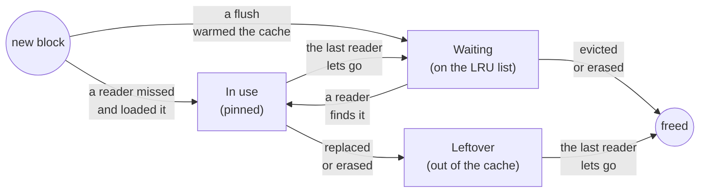
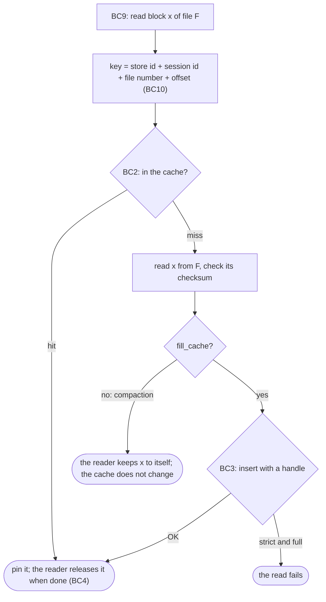

# The Block Cache

## Reference

- [RocksDB wiki: Block Cache](https://github.com/facebook/rocksdb/wiki/Block-Cache)

## Problem

A key–value store built as an LSM tree keeps new writes in memory, in a sorted buffer called a
**memtable**. When a memtable is full, a **flush** writes it to disk as an **SST file**. SST files
never change after they are written. Over time, **compaction** reads several SST files, merges
them, writes new files, and deletes the old ones.

An SST file is a sequence of **blocks** of a few kilobytes each:

- **data blocks** hold the sorted key–value pairs;
- the **index block** says which data block holds a key;
- the **filter block** (a Bloom filter) says whether a key can be in the file at all.

Reading one key from one file means reading its filter, its index, and one data block. Reading from
disk is slow. The **block cache** keeps recently read blocks in memory, so that the next read of the
same block needs no I/O.

The cache has a fixed **capacity**, in bytes. Each block counts its size, its **charge**, against
it. When a new block does not fit, the cache frees the block that was used least recently (LRU).
A block that a reader is using right now is **pinned**: it cannot be freed until the reader lets
go. One cache can be shared by every column family of many stores in one process, so they all
share one memory budget.

## How It Fits the Rest of the Store

The cache sits on the read side. These modules use it:

- **Reads**, both point reads and iterators, read SST blocks through the cache. A hit
  costs no I/O. A miss reads the block from the file and puts it in the cache.
- **Compaction** reads every block of its input files once, merges them, and writes new files. It
  uses a block that is already cached, but it does not put new blocks in the cache.
- **Flush** writes a new SST file. It may put the new file's blocks in the cache, so the first
  reads after the flush hit.
- **When compaction finishes**, its input files are obsolete. Their readers close and let go of
  any blocks they pinned. Their blocks may also be erased from the cache at once.
- The **write buffer manager** limits the memory of all memtables. It can charge that memory to the
  block cache by inserting empty "dummy" entries, which it keeps pinned. Memtables and cached
  blocks then share one budget.
- **Opening the store** starts a new cache session, so the keys of the new session never match old ones.

In the algorithms, reads reach `RetrieveBlock` (BC9) from MT7, CF5 and DB3, and compaction reaches
it from DB6 with `fill_cache = false`. A flush (MT5, DB4) calls `OnFlushOutput` (BC11). DB8 closes
an obsolete file's reader, which runs `OnObsolete` (BC11). WBM3 adds its dummy entries with
`Insert` (BC3) and removes them with `Release` (BC4). DB1 calls `NewSession` (BC10) at every open.

The earlier specifications use contracts K1 to K7 between modules. The cache relies on three more,
which the table readers and the LSM tree keep:

- **(K8)** A cache key names one block of one SST file for the life of the cache. Files never
  change, and a key is never used for other content.
- **(K9)** Every pin is released exactly once, by the reader that holds it. A table reader releases
  its pins when it closes.
- **(K10)** Compaction reads with `fill_cache = false`: a miss does not insert the block.

## State

The cache is split into **shards**, chosen by the top bits of a hash of the key. By default each
shard has at least 512 KB, and there are at most 64. Shards share nothing. Each shard keeps:

- **C**, its capacity: an equal share of the total;
- **U**, its usage: the charge of every entry that exists, pinned or not;
- **T**, a hash table from key to entry;
- **L**, the LRU list, oldest first. It holds the entries that are in T and not pinned. It has two
  parts: the low-priority part, and the **high-priority pool**. The pool may hold up to a share ρ
  of C (`high_pri_pool_ratio`). Its usage is **H**;
- `strict`, whether an insert may take the shard over C (`strict_capacity_limit`).

Each entry has a key, a value (the block), a charge, and a reference count `refs`: the number of
pins. It also has flags: in T or not, inserted with high priority, looked up at least once (hit),
and in the pool.

## The Life of a Cache Entry

A block in the cache is always in one of three states:

- **In use.** At least one reader holds it. It is pinned, so it cannot be evicted.
- **Waiting.** Nobody holds it. It sits on the LRU list, and eviction may free it.
- **Leftover.** It was removed from the cache, but a reader still holds it. It is freed when that
  reader lets go.

If the shard is over capacity when the last reader lets go, the block is freed at once instead of going back to waiting.

Only waiting blocks are on the LRU list, and eviction only takes from that list. So a block that someone is using can never be freed under them.

## The LRU List

New data blocks go to the newest end of the low-priority part. Index and filter blocks can be
inserted with high priority (`cache_index_and_filter_blocks_with_high_priority`), and any block that
was looked up at least once returns to the list with high priority. Those go to the newest end of
the pool. When the pool is over its share, its oldest entries spill into the low-priority part,
where they compete with data blocks again.

Eviction takes the oldest entry of the low-priority part first, then the oldest entry of the pool.
It stops when the new block fits, or when the list is empty. If the list is empty and the block
still does not fit, everything left is pinned. Then:

- an insert **without** a handle (nobody would hold it) is dropped, and the call succeeds;
- an insert **with** a handle fails if the cache is strict, and the read that wanted the block
  fails too;
- otherwise the insert goes ahead, and the shard goes over its capacity. The extra memory is
  pinned. When the last pin on such an entry is released while the shard is still over capacity,
  the entry is erased instead of going back on the list.

## Reads, Compaction, and a File's Life

**Cache keys.** A key must name one block and nothing else, for as long as the cache lives. A file
number alone is not enough. Two stores that share a cache both have a file 7. A store that crashes
may write file 7 again after it recovers. RocksDB puts the store's id and the id of the session that wrote the file in the key, and every
open starts a new session.

**Index and filter blocks.** By default they live in the table reader, outside the cache. With
`cache_index_and_filter_blocks` they go through the cache like data blocks. With
`pin_l0_filter_and_index_blocks_in_cache` too, the reader of an L0 file pins them for as long as it
is open.

**Flush.** With `prepopulate_block_cache = kFlushOnly`, a flush inserts the data blocks of its new
file, without pins. Compaction outputs are never inserted.

**Obsolete files.** When compaction finishes, its inputs are obsolete. Their readers close and
release their pins. Their blocks can no longer be looked up, because no reader of the file is left
and the keys are never used again. They stay in the cache until eviction takes them, unless
`uncache_aggressiveness` is set. Then they are erased at once.

## Algorithms

All eleven are written out in `BC_algorithms.tex` and `BC_algorithms.pdf`, with an overview box and an appendix of every symbol.

| Algorithm | Procedure | What it does |
|---|---|---|
| BC1 | `NewLRUCache`, `Shard(k)` | Splits the cache into shards, each with an equal share of the capacity |
| BC2 | `S.Lookup(k)` | Finds a block, pins it, and takes it off the LRU list |
| BC3 | `S.Insert(k, v, c, p, wantHandle)` | Evicts, then adds a block; refuses or drops it if it cannot fit; detaches a pinned entry it replaces |
| BC4 | `S.Release(e, eraseIfLastRef)` | Unpins; at the last release, puts the entry back on the list or erases it |
| BC5 | `S.Erase(k)`, `S.EraseUnRefEntries()` | Removes a block now, or at its last release if pinned |
| BC6 | `S.LruInsert`, `S.MaintainPoolSize`, `S.LruRemove` | The two-part LRU list and the pool's spill |
| BC7 | `S.EvictFromLRU(c)` | Frees the oldest unpinned blocks until `c` more fits |
| BC8 | `SetCapacity`, `SetStrictCapacityLimit` | Changes the options at run time |
| BC9 | `RetrieveBlock(F, x, o)` | Reads a block through the cache; with `fill_cache = false`, never inserts |
| BC10 | `NewSession()`, `CacheKey(F, x)` | Starts a new session at every open; builds a key from the store id, the session id, the file number, and the offset |
| BC11 | `OpenTable`, `OnFlushOutput`, `OnObsolete` | Pins L0 index and filter blocks; warms the cache after a flush; unpins and uncaches obsolete files |

## Invariants

The invariants are named CH1 to CH8, as in the TLA+ model (tla/BlockCache.tla).

These five matter to compaction, which holds blocks while it merges them, creates files, and makes
files obsolete:

- **CH2, pin safety.** A block that a reader holds is never freed.
- **CH3, capacity.** A shard is over capacity only when nothing in it can be evicted, and with a strict limit only after `SetCapacity` lowered the capacity.
- **CH4, no stale block.** A reader that asks for block x of file F always gets block x of F.
- **CH5, compaction does not fill the cache.** No block in the cache was put there by a compaction read.
- **CH6, no leaked pin.** Each block's pin count equals the number of readers that hold it.

These three do not change what compaction reads or keeps:

- **CH1, exact accounting.** U is the charge of every entry that exists, H the charge of the pool, and L holds exactly the unpinned entries of T.
- **CH7, pool bound.** H is at most ρ·C.
- **CH8, WBM charge.** Every dummy entry the write buffer manager asked for is in the cache.

## Document underspecification in the Wiki:

(a) The wiki says that when a strict cache is full, the insert fails and so does "the read or iteration", but never says what happens to an insert that no reader will hold. BC3 drops such a block and returns OK. Without this rule, a flush that warms a full strict cache (BC11) would fail, although its file is already safe on disk.

(b) The wiki says a cache without a strict limit may go over capacity when pinned blocks fill it, but never says how it comes back. BC4 erases an entry, instead of putting it back on the LRU list, when its last pin is released while the shard is over capacity. Without this, the shard stays over capacity with blocks that nobody holds, and CH3 fails.

(c) The wiki never says what happens when two readers miss on the same block and both insert it. BC3 puts the new entry in the table and detaches the old one, which its reader keeps until BC4 frees it. If the old entry were freed at once, its reader would read freed memory, and CH2 fails 

(d) The wiki never says that compaction reads with `fill_cache = false`. BC9 reads a missed block without inserting it. Without this, a compaction pushes out the blocks users read with blocks it reads only once, and CH5 fails (TLC: MC_Bug_CompactionFills). Even with this rule, a compaction hit can still evict a hot block when users have taken the shard over capacity.

(e) The wiki says index and filter blocks can go to the high-priority pool, but never says that any block looked up once also goes there when it is released. BC6 sends every hit block to the pool. A reader of the wiki expects data blocks always to be low priority, and does not see that a large compaction's hits can push index and filter blocks out of the pool. 

(f) The wiki never says how a cache key is built, or that it must stay unique when stores share a cache or a store reuses a file number after a crash. BC10 builds the key from the store's id, the session that created the file, its file number, and the block's offset, and starts a new session at every open. With the file number alone, a reader gets another file's block, and CH4 fails 

(g) The wiki never says what happens to the blocks of a file that compaction made obsolete. BC11 releases the file's pins when its reader closes, and leaves its blocks in the cache until eviction, unless `uncache_aggressiveness` is set. Without the release, the deleted file's blocks stay pinned forever and CH6 fails; without the erase, dead blocks take space that live blocks could use. 

(h) The wiki says the capacity can be changed at run time, but never says what happens to the high-priority pool. BC8 follows RocksDB, which evicts but does not spill the pool. So after the capacity is lowered, the pool can stay over its new share, and CH7 fails until the next high-priority insert.

(i) The wiki says the write buffer manager can charge memtable memory to the block cache, but never says what happens when that cache is strict and full. BC3 refuses the dummy entry like any pinned insert. The memtable memory then goes uncharged, so the process uses more memory than the cache's budget, and CH8 fails.

