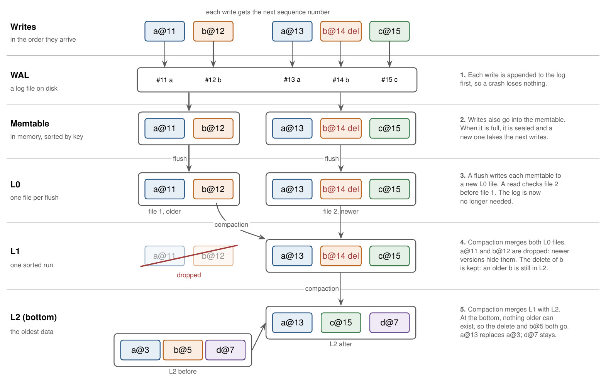
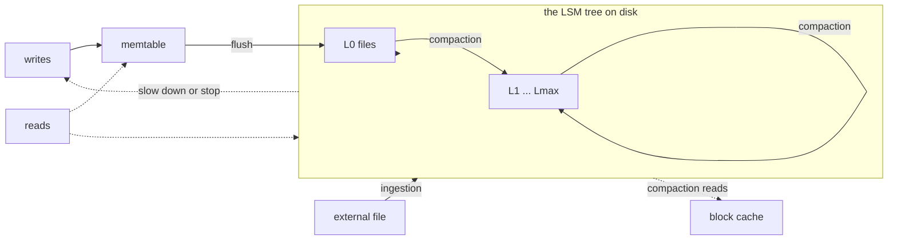

# The LSM Tree and Its Compaction

## Reference

- P. O'Neil, E. Cheng, D. Gawlick, and E. O'Neil,
  [The Log-Structured Merge-Tree (LSM-Tree)](https://www.cs.umb.edu/~poneil/lsmtree.pdf), Acta
  Informatica 33(4), 1996
- M. Callaghan, [The original LSM paper](https://smalldatum.blogspot.com/2018/06/the-original-lsm-paper.html),
  Small Datum, June 2018
- RocksDB wiki: [Compaction](https://github.com/facebook/rocksdb/wiki/Compaction),
  [Leveled Compaction](https://github.com/facebook/rocksdb/wiki/Leveled-Compaction),
  [Universal Compaction](https://github.com/facebook/rocksdb/wiki/Universal-Compaction),
  [Choose Level Compaction Files](https://github.com/facebook/rocksdb/wiki/Choose-Level-Compaction-Files)


## Problem

A key–value store built as an LSM tree keeps new writes in memory, in a sorted buffer called a memtable. Every write gets a sequence number. A delete is a write which leaves a deletion marker (a tombstone). When a memtable is full, a flush writes it to disk as an SST file, a sorted file that never changes. New SST files go to level 0 (L0). 

A read must look for a key at different places namely the memtable, every L0 file, and each deeper level. This can cause reads to become slow, and old versions and tombstones stay on disk, which causes space to grow. Compaction is aimed at fixing these issues. It is responsible for reading files, merging them when appropriate, and dropping versions that are no longer relevant.

Compaction sets three costs that trade against each other:

read amplification: how many places a read checks;
write amplification: how many times each byte is rewritten on its way down;
space amplification: how much dead data sits on disk.

In this project we only consider the Leveled and Universal compaction strategies.

### From the paper to RocksDB

O'Neil et al. proposed a tree of components C0, C1, …, CK. C0 is in memory, the others are on
disk, and each is about r times larger than the one before. Between each pair of neighbors, a
**rolling merge** runs all the time. A cursor moves through the key space. Each step reads a block
of the larger component, merges in the entries of the smaller one in the same key range, and
writes the result to a new place on disk. The paper shows that, for a fixed total size, I/O is
lowest when every size ratio is the same r.

RocksDB keeps the idea and changes the mechanics. C0 becomes the memtable, and C1, C2, and so on
become the levels L1, L2, and so on. RocksDB adds a level the paper does not have, L0, where each
flush leaves one file and files may overlap. The rolling merge was all-to-all: it merged a whole
component into the next. A RocksDB compaction is some-to-some: it merges one file of L_n, or a few,
with the files of L_n+1 they overlap. The rolling merge was also incremental, so each step was
visible at once. A compaction is atomic: its outputs appear all at once, when the job ends. The
paper's cursor lives on as the compact cursor of `compaction_pri = kRoundRobin`, and its emptying
and filling blocks become a compaction's input and output files. Finally, the paper's result that
equal size ratios are optimal is why RocksDB uses one `max_bytes_for_level_multiplier`, and why
dynamic level bytes derives every target from the last level.

## How It Fits the Rest of the Store

The LSM tree is the data structure that holds the store's data, and compaction is what keeps it
in shape. Its top is the memtable in memory. Below it, on disk, are the SST files: L0 holds the
newest files, straight from flushes, and each deeper level holds older data in larger, sorted
files. Data enters at the top and moves down over time. Compaction does that moving: it takes
files from one level, merges them with what lies below, and writes the result one level down.

The picture below follows five writes through the write path, and then through two compactions.
Each write gets a sequence number; `a@13` means version 13 of key `a`. L2 already holds older data
from earlier writes, and no snapshot is open.



Two things happen on the way down. A version is dropped once a newer version of the same key hides
it, as `a@11` is in step 4. A delete is kept as long as an older version of its key may exist below
it, and dropped, with that older version, once it reaches the bottom (step 5).

The other parts of the store decide how data gets into the tree, how it is read, and how fast
writes may come. Compaction has to work with each of them, in the following ways.



- **Flush.** When the memtable is full, it is written to disk as a new file and becomes the
  newest file of L0. This is how new writes reach the disk part of the tree. Each new L0 file makes
  L0 a little fuller, and may make a compaction due.
- **Ingestion.** A user can also hand the store a sorted file built elsewhere. The store puts it as
  deep in the tree as it can without hiding newer data. Compaction must allow for this: such a file
  may later land below data that compaction wanted to clean up, and it must not land where a
  running compaction is about to write.
- **Reads.** A read looks in the memtable first, then in the L0 files from newest to oldest, then in
  each deeper level, and stops at the first version of the key it finds. Compaction moves data
  around under these reads, so it must never change what a read returns.
- **The block cache.** Recently read pieces of files are kept in memory, so that reads are fast.
  Compaction reads every piece of its input files once. It uses the cache, but does not add what it
  reads to it, so that it does not push out the pieces users need.
- **Write speed.** If compaction cannot keep up, L0 fills up and reads slow down. The store then
  slows new writes down, and at last stops them, until compaction catches up.

The other parts of the store are specified on their own, each with numbered steps:

| Part | Folder | Algorithms | What it covers |
|---|---|---|---|
| Write-ahead log | `wal/` | WAL1 to WAL9 | accepting, logging, and making writes visible; recovery after a crash |
| Memtables, column families, SST files | `memtable_sst/` | MT1 to MT7, CF1 to CF5, SST1 to SST4 | the memtable, flush, reads, column families, ingesting external files |
| Write buffer manager | `write_buffer/` | WBM1 to WBM9 | the memory limit on memtables |
| Block cache | `block_cache/` | BC1 to BC11 | caching SST blocks for reads |

In the step names of the other parts: flush is MT5 and MT6, ingestion is SST3, reads are MT7 (one
key) and CF5 (iterators), a cached read is BC9, and the write path checks the stall rule (LSM12 here)
in WAL1.

Between the parts, the earlier specifications state contracts, numbered K1 to K10: K1 to K4 between
the WAL and the memtables (for example, K4: every change to the set of files is one record in the
MANIFEST, written all at once after its files are on disk), K5 to K7 for the write buffer manager,
and K8 to K10 for the block cache (K10 is the rule that compaction does not fill the cache). The LSM tree relies on K4 and K10, and
adds three of its own:

- **(K11)** A flush adds its file to the top of L0, with an epoch larger than every other file's,
  and every version in it is newer than every version in the files.
- **(K12)** A compaction learns every live snapshot when it starts. A snapshot taken later has a
  sequence number at least as large as every version in the inputs.
- **(K13)** Every reader holds a reference to the version it reads until it is done. This includes
  Get, iterators, flushes, and compactions.

## The Data Structure

These are the fields of the LSM tree, for one column family. The other parts of the store (the
log, the write buffer manager, the block cache) keep their own fields and are not listed here.

```
Data structure LSMTree
    mem          : Memtable                 the memtable that takes new writes
    imm          : list of Memtable         full memtables waiting to be flushed, oldest first

    version      : Version                  the current list of files, per level
    oldVersions  : Version → ℕ              older lists that readers still use, with how many readers each
    jobs         : set of CompactionJob     the compactions running now
    busy         : set of FileId            the files those compactions are reading
    cursor       : Level → Key              where each level's last compaction stopped (kRoundRobin only)

    snapshots    : set of SeqNo             the open snapshots
    lastSeq      : SeqNo                    the sequence number of the last write
    nextFileId   : ℕ                        the number the next new file gets
    pending      : set of FileId            the first file number of each job still writing files
    nextEpoch    : ℕ                        the epoch the next L0 file gets

Data structure Version
    L0           : list of SstFile          newest first; files may hold the same keys
    L1 ... Lmax  : list of SstFile          one list per level, in key order; files never overlap

Data structure SstFile                      written once, never changed
    id           : FileId                   its number; also its file name
    epoch        : ℕ                        L0 only: higher means newer
    smallest     : Key                      its first key
    largest      : Key                      its last key
    entries      : list of Entry            sorted by key, and newest first within a key
    size         : bytes

Data structure Entry                        one version of one key
    key          : Key
    seq          : SeqNo                    the write's sequence number; higher means newer
    type         : Put or Delete
    value        : bytes                    empty for a Delete

Data structure CompactionJob
    inputs       : set of SstFile           the files it merges, from one or more levels
    outputLevel  : Level                    where its new files go
    snapshots    : set of SeqNo             the open snapshots when it started
    outputs      : list of SstFile          the files it has written so far
```

Some values are not stored, because they follow from the fields above. A level's size is the sum
of its files' sizes. Its target size, its score, and the base level come from those sizes and the
options. The sorted runs come from the version: each L0 file is one run, and each deeper level is
one run.

A flush adds a file to the front of `L0` with the next epoch. A compaction takes its `inputs` out of
the version and puts its `outputs` in, in one step. A file leaves the disk only when neither
`version` nor any of `oldVersions` lists it. A file whose number is at or above the smallest
number in `pending` may still be being written, so it is never deleted either.

## State

The state contains the list of the tree's files and the level each one sits in. It also contains
the older file lists that readers still use, a busy mark on each file that a compaction is using,
the target size and score of each level, the key where each level's last compaction stopped, the
open snapshots, the last sequence number, and the next file number.

**The list of files.** The files themselves never change once written. What changes is the list:
which files are in L0, which are in L1, and so on. In the picture above, after step 4 the list
says "L0 is empty, L1 has one file with a, b and c, and L2 has one file with a, b and d". This list
is called a **version**. Every flush and every compaction makes a new version: it takes some files
off the list and adds others. The store writes each change to a small log of its own, the
**MANIFEST**, in one record, so that after a crash it finds the list exactly as it was.

The order of files matters to reads. In L0, files may hold the same keys, so they are kept newest
first, and a read checks the newest one first. Each new L0 file gets a number one higher than the
last, its **epoch**, which records this order. In L1 and below, files never share keys, so they are
simply kept in key order, and a read knows which one file to open.

**Old lists that are still in use.** A reader that started before a compaction keeps using the list
it started with. Its files must stay on disk until it is done, even if the newest list no longer
has them. So the store keeps every old version that some reader still holds, and deletes a file only
when no version lists it.

**Which files are being compacted.** A compaction can take seconds or minutes, and several run at
once. Each file has a **busy** mark while a compaction is using it, so that no other compaction
picks it too.

**How full each level is.** Leveled compaction gives each level a **target size**, about ten times
the level above. A level's **score** is how full it is compared to its target. The fullest level is
compacted next. The highest level that gets data straight from L0 is the **base level**.

**Where the last compaction stopped.** With one of the picking rules (`kRoundRobin`), each level
remembers the key where its last compaction ended, and the next one starts there. This is the cursor
of the original paper.

**Snapshots and counters.** The store also remembers which **snapshots** are open (a snapshot lets a
reader see the data as it was at one moment, so compaction must keep the versions it can see), the
last sequence number given to a write, and the next number for a new file.

### Sorted runs

A **sorted run** is a set of files that together hold each key at most once, in key order. Each L0
file is a sorted run on its own. Each deeper level is one sorted run, however many files it has. In
the picture, after step 3 the tree has three runs: file 2, file 1 and L2. A read checks the runs
from newest to oldest and stops at the first version of the key it finds. Universal compaction
thinks in runs: it merges a few runs that sit next to each other in age into one.

The step that computes the targets and scores is LSM4, and the one that lists the runs is LSM2.

## Leveled Compaction

Leveled compaction keeps the tree as a stack of levels that grow by a fixed factor. L0 holds the
files that flushes just wrote. Below it, L1, L2, and so on each hold data in sorted files that never
share a key, so a read opens at most one file per level. Each level is allowed about ten times as
much data as the level above it. When a level holds more than it is allowed, one of its files is
merged into the level below.

Here is one step. L1 is over its size, and L2 below it has four files:

```
L1:  [a..f]  [g..m]  [n..z]
L2:  [a..c]  [d..k]  [l..r]  [s..z]
```

Compaction picks one file of L1, say `[g..m]`. That file holds keys from g to m. In L2, the files
`[d..k]` and `[l..r]` hold keys in the same range, so they must join the merge: otherwise L2 would
end up with two files that both hold, say, key h. Compaction merges the three files, keeps only the
newest version of each key, and writes new L2 files in their place:

```
L1:  [a..f]          [n..z]
L2:  [a..c]  [d..h]  [i..r]  [s..z]
```

`[a..c]` and `[s..z]` were never touched. This is the point of leveled compaction: each step
rewrites only one small slice of the tree, and the levels stay sorted.

A few rules decide the details:

- **Which level.** Each level gets a score: how much data it holds compared to what it is allowed.
  For L0 the score counts files instead, because every L0 file is one more place a read must check.
  The level with the highest score goes first, once its score reaches 1.
- **Which file.** By default, the file whose key range overlaps the least data in the level below,
  because that merge rewrites the fewest bytes. Another rule simply takes the files in key order,
  starting where the last compaction of that level stopped.
- **Whole keys only.** If the file picked shares a key with its neighbor in the same level (two
  versions of one key can end up in neighboring files), the neighbor joins too. In L0, files may
  hold any keys, so a pick from L0 takes every L0 file whose keys overlap it, older ones included.
  Otherwise a newer version could move down and leave an older one above it.
- **No sharing.** A file that another compaction is already using is skipped, and so is a key
  range that another compaction is about to write in the level below. Several compactions can then
  run at once without touching the same data.
- **Moving without merging.** If nothing in the level below overlaps the file picked, the file is
  just moved down. Nothing is rewritten.
- **Where L0 goes.** When the tree is small, the upper levels would have tiny targets. They stay
  empty, and L0 is merged straight into the first level that has a real target, the **base level**.

In RocksDB these rules are set by `max_bytes_for_level_base` and `max_bytes_for_level_multiplier`
(the sizes), `level_compaction_dynamic_level_bytes` (the base level), `level0_file_num_compaction_trigger`
(the L0 score), and `compaction_pri` (which file). The steps are LSM3, LSM4, and LSM5.

## Universal Compaction

Universal compaction lets data pile up in a few large sorted chunks, and merges several chunks at
once when they become worth merging. Each chunk is a **sorted run**: a set of files that together
hold each key at most once, in key order. Every flush makes a new run. Runs are ordered by age, and
a read checks them from newest to oldest. Universal compaction rewrites data less often than
leveled compaction, but a read may have to check more runs, and old data may sit on disk longer.

Here is one example. The tree has four runs, newest first:

```
run 1: 1 MB   run 2: 1 MB   run 3: 2 MB   run 4: 30 MB
```

The three newest runs are about the same size: run 2 is no bigger than run 1, and run 3 is no
bigger than runs 1 and 2 together. Merging them is cheap and cuts the number of runs a read checks
from four to two. Run 4 is much bigger than the three together, so merging it now would rewrite
30 MB to tidy up 4 MB. Compaction merges runs 1 to 3 into one run of about 4 MB and leaves run 4
alone:

```
run A: 4 MB   run 4: 30 MB
```

The new run takes the place of the three it replaced: it is newer than run 4, so a read still
checks it first.

Universal compaction waits until the tree has a set number of runs. Then it looks for a reason to
merge, in this order:

1. **Old data.** Some runs hold data older than a set age. They are merged so that old versions
   and deletes finally get cleaned up.
2. **Too much space.** All the newer runs together are large compared to the oldest run. Much of
   that space may be old versions of the same keys, so everything is merged into one run.
3. **Similar sizes.** Starting from the newest run, a group of runs that grow slowly in size, as in
   the example above.
4. **Too many runs.** If nothing else applies, just enough of the newest runs are merged to bring
   the count back down.

Whatever the reason, compaction only merges runs that are **next to each other in age**. If it
merged runs 1 and 3 and skipped run 2, the result would hold data both newer and older than run 2,
and no position in the age order would be right for it. A read could then find an old version of a
key before a newer one. Two compactions also never share a run.

The result goes where the merged runs were, as low in the tree as the age order allows. If the
oldest run merged is a level, the result goes into that level. If it is an L0 file, the result goes
just above the next older run: into L0 if that run is an L0 file, or into the level above it
otherwise. If no older run exists, the result goes to the last level. A result written to L0 stays
one file, because each L0 file counts as one run.

In RocksDB these rules are set by `compaction_style = kCompactionStyleUniversal`,
`level0_file_num_compaction_trigger` (how many runs to wait for), and `compaction_options_universal`:
`size_ratio`, `min_merge_width` and `max_merge_width` (similar sizes),
`max_size_amplification_percent` (too much space), and `periodic_compaction_seconds` (old data).
With `allow_ingest_behind`, the last level is kept for ingested files and is never merged. The step
is LSM6.

## The Compaction Job

Leveled and universal compaction choose different files, but once the files are chosen, both run
the same job. The job reads the chosen files, merges them into one sorted stream, drops the
versions nobody can read any more, writes the rest as new files, swaps the new files in for the old
ones, and finally deletes the old files.

Here is the job from step 4 of the key picture. Each write has a sequence number, and `a@13` means
version 13 of key `a`. The job takes the two L0 files and writes into L1. L2 below already holds
older data:

```
input, L0 file 1:  a@11  b@12
input, L0 file 2:  a@13  b@14 (delete)  c@15
below, L2:         a@3   b@5   d@7
```

The merge reads the inputs in key order, and the versions of each key from newest to oldest:

```
a@13  a@11  b@14 (delete)  b@12  c@15
```

It keeps `a@13` and drops `a@11`, because a read of `a` will always find `a@13` first. In the same
way it keeps the delete `b@14` and drops `b@12`. It must keep the delete itself, because L2 still
holds `b@5`: without the delete, a read of `b` would go down to L2 and find the old value. The job
writes one new L1 file, `a@13  b@14 (delete)  c@15`, and the two L0 files go away.

The job follows these rules.

**Which versions stay.** A version can be dropped only if no reader can ever see it. Normally a
reader sees only the newest version of each key, so only that one stays. Snapshots change this. A
snapshot lets a reader see the data as it was at one moment, so the version that was newest at that
moment must stay too. Had a snapshot been taken right after write 12 in the example, it would read
`a@11` and `b@12`, and the job would keep both. In general, the open snapshots cut the history of
each key into stretches, and the job keeps the newest version in each stretch.

**When a delete may go.** A delete hides older versions of its key. It can be dropped only when no
older version of the key can exist anywhere below the job's output, and no open snapshot can still
see an older value. In the example, the delete stays because of `b@5`. When a later job merges L1
into L2, the bottom of the tree, the delete and `b@5` meet, and both go. One option changes this:
if the store allows files to be added later below all other data, the job can never be sure that
nothing older is below, so it never drops a delete.

**Writing the new files.** The job cuts its output into files of a target size, so that later jobs
can pick small pieces. It never cuts between two versions of the same key, so that a key never
spreads over two files of one level. If the output goes to L0 (only universal compaction does that),
the job writes one file, because each L0 file counts as one sorted run.

**Swapping the files.** The store keeps a list of its files per level, and saves every change to
that list as one record in a small log, the MANIFEST. The job removes its inputs and adds its
outputs in one such record. A reader therefore sees either the old files or the new ones, never a
mix, and after a crash the store finds one or the other.

**Deleting the old files.** A reader that started before the swap still reads the old files. The
store deletes an old file only when no reader is using a list that contains it.

**Running in the background.** Jobs run in background threads, several at a time, while writes and
reads go on. If the jobs fall behind, L0 fills up and reads slow down. The store then slows new
writes down, and at last stops them, until the jobs catch up.

In the step names, the merge is LSM7, writing the files is LSM8, the swap is LSM9, deleting old
files is LSM10, scheduling is LSM11, and slowing writes is LSM12. The file size is set by
`target_file_size_base` and `target_file_size_multiplier`, and the option that keeps every delete is
`allow_ingest_behind`.

## Algorithms

| Algorithm | Procedure | What it does |
|---|---|---|
| LSM1 | `RollingMerge(i)` | The paper's rolling merge between C_i and C_i+1, with its cursor |
| LSM2 | `SortedRuns(v)`, `GetInLevel(n, k, s)` | The shape of the tree, and how a read walks it |
| LSM3 | `Overlapping(n, a, b)`, `ExpandToCleanCut(n, I)` | Files that overlap a range; grow a pick to whole user keys |
| LSM4 | `LevelTargets(v)` | Base level, target sizes, and scores (static and dynamic level bytes) |
| LSM5 | `PickLeveled(v, due)` | Level, file, clean cut, output overlap, busy check, trivial move |
| LSM6 | `PickUniversal(v)` | Periodic, size amplification, size ratio, run count; output level |
| LSM7 | `CompactionIterator(p, S; C)`, `KeyNotExistsBeyond(k, p)` | Which versions survive: snapshot stripes, deletions at the bottom; inputs are read through the block cache without filling it (BC9) |
| LSM8 | `WriteOutputs(E, o)` | Cut the merged stream into files, never inside a user key |
| LSM9 | `InstallCompaction(p, out, m)` | One MANIFEST record swaps the inputs for the outputs (K4) |
| LSM10 | `Ref`, `Unref`, `PurgeObsoleteFiles` | A file is deleted only when no live version lists it and no job may still be writing it (DB8, BC11) |
| LSM11 | `MaybeSchedule`, `BackgroundCompaction` | The compaction loop |
| LSM12 | `T.StallState()` | Go, Delay or Stop for the write path (WAL1, DB10), from the memtables waiting to flush, the L0 files or sorted runs, and the compaction debt |

## Invariants

These are the properties that need to be respected for compaction. 

LS1, levels do not overlap : In L1 and every deeper level, each file holds its own stretch of keys.
LS2, newer above older: A read always meets the newer version of a key before an older one.
LS3, reads never change: A read, or a read from a snapshot, returns the last value written before it, whatever compaction does.
LS4, no shared work:  Two running compactions never use the same file or write the same keys into the same level.
LS5, readers keep their files: No file is deleted while a reader still uses it.

Two more rules are checked too, but they are mostly for bookkeeping:

LS6, current files exist: Every file in the store's current list is on disk.
LS7, one copy: Each version of a key is in exactly one file.

The sections above show how compaction keeps each rule. It takes every overlapping file of the level below (LS1), and it moves whole keys and merges only runs next to each other in age (LS2). It keeps what readers and snapshots can still see, and drops a delete only at the bottom (LS3). It skips busy files (LS4), and it deletes old files only after their readers are done (LS5).

## Document underspecification in the Wiki:

(a) The wiki says that L0 files overlap, so an L0 compaction "normally" picks up all of them, but never says which smaller set is safe. LSM3 and LSM5 take the file picked and every L0 file that overlaps it, older ones too, and keep growing the set until no other L0 file overlaps it. Without this, the newer version of a key moves down to L1 while an older L0 file still holds an older version above it, and a read returns the old value.

(b) The wiki says a pick grows to include neighboring files that share a user key (a "clean cut"), but never says why. LSM3 grows the pick until it holds every version of every key in its range. This is needed only because an output file may end between two versions of one key; LSM8 never cuts there, and then the growth never adds a file. Without it, the file with the newer version can move down below the file with the older one, and a read returns the old value. *(unchecked)*

(c) The wiki says a pick takes the files it overlaps in the next level, but never says that this is also what makes deleting safe. LSM5 takes every overlapping file of the output level. If one is left out, the merge cannot see the older value it holds, believes nothing is below, and drops a delete, so the deleted value comes back.

(d) The wiki says compaction drops versions that are no longer needed, but never says which ones are. LSM7 keeps, for each key, the newest version that each open snapshot can see, and drops the rest. Without this rule, a snapshot read finds a version that a compaction removed and returns a different value than it did before.

(e) The wiki says deletes are removed when they reach the bottom, but never says what "the bottom" means for one compaction. LSM7 drops a delete only when no file outside the job, at the output level or below it (or in an older L0 file), holds its key, and no snapshot can still see an older value. Without this, a delete that meets no older value in its own inputs is dropped while an older value still sits deeper, and that value comes back.

(f) The universal compaction page explains how runs are chosen by size, but never says that only runs next to each other in age may be merged, or where the result goes. LSM6 merges only neighbors in age, and puts the result where they were: in the level of the oldest run merged, or just above the next older run, or in the last level if there is none. Without this, the result holds data both newer and older than a run it skipped, and a read can find an old version before a newer one. *(unchecked)*

(g) The wiki says universal compaction can write its result into L0, but never says that the result must then be a single file. LSM8 never cuts an output to L0, because each L0 file counts as one sorted run. If it is cut into two files of the same age, a later compaction can take one of them with an older run, put the result below the other, and bring a deleted value back. *(unchecked)*

(h) The wiki says `allow_ingest_behind` reserves the last level for files ingested behind all data, but never says what this asks of compaction. LSM7 never drops a delete while the option is on, LSM5 never writes to the last level, and LSM6 leaves the last level's run out of every pick. Without these rules, a delete is dropped and a later ingest-behind file brings the old value back, or a compaction puts newer data into the reserved level beside the next ingested file. (Item (l) of the memtable document is the same gap seen from ingestion.) *(unchecked)*

(i) The wiki says that several compactions can run at once, but never says how they stay apart. LSM5 and LSM6 skip any file another compaction is using, and LSM5 also skips a key range that a running compaction will write in the output level. Without this, two jobs install overlapping files into one level, or one job deletes a file the other is still merging.

(j) The wiki says ingestion places a file in the lowest level it fits, but never says what happens while a compaction is running. SST3 stops above any level where a running compaction will install output that overlaps the file's range. Without this, the compaction installs its output next to the ingested file, and the level holds two files with the same keys.

(k) The wiki says an obsolete SST file is deleted, but never says how the store avoids deleting a file that a compaction is still writing, which no version lists yet. LSM10 (DB8) deletes a file only if no live version lists it and its number is below the smallest number of every job still writing. Without this, a purge that runs during a long compaction can delete its half-written output.

(l) The wiki says compaction reads use the block cache, but never says whether they add what they read to it. LSM7 reads its inputs through BC9 with `fill_cache = false` (K10), so one large compaction does not push out the blocks that user reads need. *(unchecked)*

The items marked *(unchecked)* rest on what we know of the RocksDB code and should be checked against its source.
