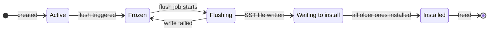
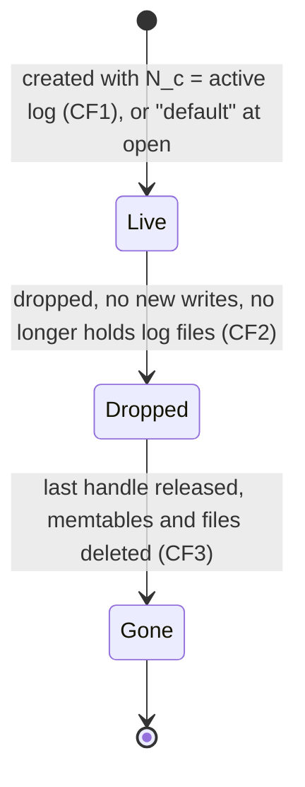

# MemTable, Column Families, and SST Files

## Reference

- [RocksDB wiki: MemTable](https://github.com/facebook/rocksdb/wiki/MemTable)
- [RocksDB wiki: Column Families](https://github.com/facebook/rocksdb/wiki/Column-Families)
- [RocksDB wiki: Creating and Ingesting SST files](https://github.com/facebook/rocksdb/wiki/Creating-and-Ingesting-SST-files)

## Problem 
The main reasons a key value store built using an LSM tree splits its data between memory and disk is to ensure durability and speed. Updating each key in place on the disk would be a random write for each update which is extremely slow. So the key value store batches the writes as one large sorted file and writes it to the disk. This impacts the cost of reads as the key may be in memory or in any of the several files. 

The part of the data that is in memory is kept as a sorted buffer and is called the MemTable. Every new write goes into it, and every read checks it first, because it holds the newest data. When it is full (write_buffer_size, 64 MB by default), it is frozen. A frozen memtable takes no more writes but still answers reads. A new, empty memtable takes its place in the same step as the freeze, so there is always exactly one memtable taking writes.

The freeze does not happen the instant the memtable fills up. The write that fills it only marks it as full. The freeze happens at the start of the next write, before that write is logged. It also waits until every write already logged has been inserted into a memtable. Otherwise a late write could land in the new memtable, in front of a newer one.

The part of the data that is on the desk is a file of key–value pairs in key order which never changes once written and is called the SSTable. It has an index and a Bloom filter, so a lookup reads only a few blocks. Writing a frozen memtable to a new SST file is called a flush. New SST files go into level 0 (L0). Compaction later merges them into deeper levels L1, L2, and so on. An SST file can also be built outside the store and brought in directly. This is called ingestion. 

Each write gets a sequence number that says how new it is. Newer data always sits above older data. A read checks the memtable, then the frozen memtables, then L0, then each deeper level, and stops at the first version it finds. Compaction depends on the same rule.

A memtable lives in memory, so a crash would lose every write that has not been flushed yet. The write-ahead log (WAL) fixes this. Each write goes to a log file on disk before it goes into the memtable. If the store crashes, it replays the log to rebuild the memtables. Once a memtable has been flushed to an SST, its log records are no longer needed, and old log files can be deleted. The WAL is specified separately (algorithm/wal/wal.md)

## System Model

The LSM tree (T) holds everything for each column family: the active memtable, the frozen memtables, and the SST files. L0 files may overlap each other and are kept newest first. In L1 and deeper, the files of one level never overlap.

The MANIFEST is a file that records which column families and SST files exist, each column family's log number N_c, and the last sequence number used. Every change to it is written in one step, all or nothing, after the files it mentions are safely on disk.

A memtable (M) is a sorted buffer in memory. It can insert, look up a key, and say whether it is full or empty.

The WAL is the log described in algorithm/wal/wal.md

## Memtable Life Cycle

Each column family has one active memtable at a time. A memtable goes through five stages:

1. **Active.** It takes new writes and answers reads.
2. **Frozen.** A flush was triggered. It takes no more writes, but still answers reads. A new, empty
   memtable becomes active in the same step, and the WAL starts a new log file (MT4, called from WAL6a).
3. **Flushing.** A background job is writing it to an SST file (MT5). If the write fails, the memtable
   goes back to Frozen and is tried again later.
4. **Waiting to install.** Its SST file is written, but older frozen memtables are not installed yet.
   Files are installed strictly oldest first.
5. **Installed.** Its SST file is now in L0, and the MANIFEST says so (MT6). The memtable is no longer
   needed. It is freed once no reader is using it.

Until the memtable is installed, reads still check it.

Two settings change this picture. If too many frozen memtables pile up (`max_write_buffer_number`),
new writes wait until a flush finishes. If `max_write_buffer_size_to_maintain` is set, some installed
memtables are kept in memory for a while instead of being freed.

## Flush Triggers

| Trigger | Detected by | What is flushed |
|---|---|---|
| A memtable is full (`write_buffer_size`) | MT3, called in WAL4a | that column family |
| All memtables together are over `db_write_buffer_size` | the write buffer manager, in WAL1 | the column family with the oldest memtable |
| The log files are over `max_total_wal_size` | WAL5 | every column family that needs the oldest log file |
| The user calls `Flush` | the user | the named column families |
| An ingested file overlaps a memtable | SST2 | that column family |

The wiki says the write buffer manager flushes the *largest* memtable. We believe the current RocksDB
code (`HandleWriteBufferManagerFlush`) flushes the *oldest* one, and this design follows that. This
should be checked against the RocksDB version being studied.

## Column Families

A column family is a separate key space inside one store. Every key belongs to exactly one. The
"default" column family always exists and cannot be dropped.

Column families share the WAL and the sequence numbers. They share nothing else. Sharing the WAL
makes a batch that writes to several column families atomic. Sharing sequence numbers gives
iterators over several column families one consistent view (CF5). Because memtables and files are
separate, each column family can be tuned, flushed, and dropped on its own.

Sharing the log has a cost. Any freeze, in any column family, starts a new log file for all of them.
A log file can be deleted only after every column family has flushed the writes in it. So a column
family that is rarely written keeps old log files alive, until WAL pressure forces it to flush.

When a column family is dropped, it stops taking writes and stops holding on to log files. Its data
stays readable through any handle that is still open. The data is deleted when the last handle is
released. A read-write open must list every column family in the store.

