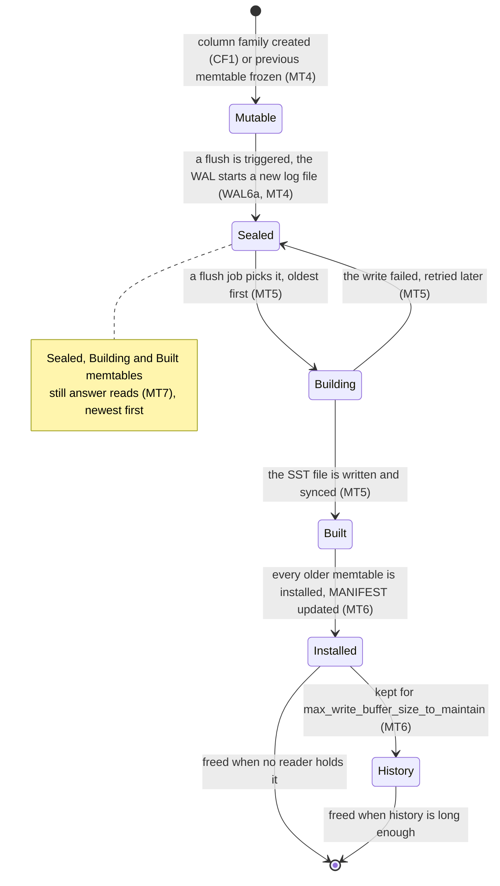

# MemTable, Column Families, and SST Files

## Reference

- [RocksDB wiki: MemTable](https://github.com/facebook/rocksdb/wiki/MemTable)
- [RocksDB wiki: Column Families](https://github.com/facebook/rocksdb/wiki/Column-Families)
- [RocksDB wiki: Creating and Ingesting SST files](https://github.com/facebook/rocksdb/wiki/Creating-and-Ingesting-SST-files)

## Problem 
The main reasons a key value store built using an LSM tree splits its data between memory and disk is to ensure durability and speed. Updating each key in place on the disk would be a random write for each update which is extremely slow. So the key value store batches the writes as one large sorted file and writes it to the disk. This impacts the cost of reads as the key may be in memory or in any of the several files. 

The part of the data that is in memory is kept as a sorted buffer and is called the MemTable. Every new write goes into it, and every read checks it first, because it holds the newest data. When it is full (write_buffer_size, 64 MB by default), it is frozen. A frozen memtable takes no more writes but still answers reads. A new, empty memtable takes its place in the same step as the freeze, so there is always exactly one memtable taking writes.

The freeze does not happen the instant the memtable fills up. The write that fills it only marks it as full. The freeze happens at the start of the next write, before that write is logged. It also waits until every write already logged has been inserted into a memtable. Otherwise a late write could land in the new memtable, in front of a newer one.

The part of the data that is on the desk is a file of key–value pairs in key order which never changes once written and is called the SSTable. It has an index and a Bloom filter, so a lookup reads only a few blocks. Writing a frozen memtable to a new SST file is called a flush. New SST files go into level 0 (L0). Compaction later merges them into deeper levels L1, L2, and so on. An SST file can also be built outside the store and brought in directly. This is called ingestion. 

Each write gets a sequence number that says how new it is. Newer data always sits above older data. A read checks the memtable, then the frozen memtables, then L0, then each deeper level, and stops at the first version it finds. Compaction depends on the same rule.

A memtable lives in memory, so a crash would lose every write that has not been flushed yet. The write-ahead log (WAL) fixes this. Each write goes to a log file on disk before it goes into the memtable. If the store crashes, it replays the log to rebuild the memtables. Once a memtable has been flushed to an SST, its log records are no longer needed, and old log files can be deleted. The WAL is specified separately (algorithm/wal/wal.md)

## System Model

The LSM tree (T) holds everything for each column family: the active memtable, the frozen memtables, and the SST files. L0 files may overlap each other and are kept newest first. In L1 and deeper, the files of one level never overlap.

The MANIFEST is a file that records which column families and SST files exist, each column family's log number N_c, and the last sequence number used. Every change to it is written in one step, all or nothing, after the files it mentions are safely on disk.

A memtable (M) is a sorted buffer in memory. It can insert, look up a key, and say whether it is full or empty.

The WAL is the log described in algorithm/wal/wal.md

## MemTable LifeCycle 

A memtable starts empty and takes writes until a flush is triggered. During flush it is frozen and joins the queue of frozen memtables. A background job writes it to an SST file. The result is installed only after every older frozen memtable of the same column family is installed. Post that, the memtable is freed, or kept for a while if max_write_buffer_size_to_maintain asks for it.

If too many frozen memtables are waiting (max_write_buffer_number), writes stall until a flush finishes.

