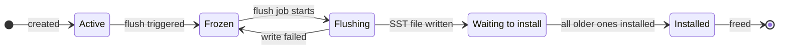
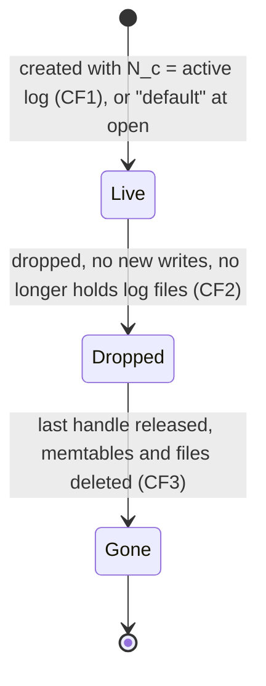
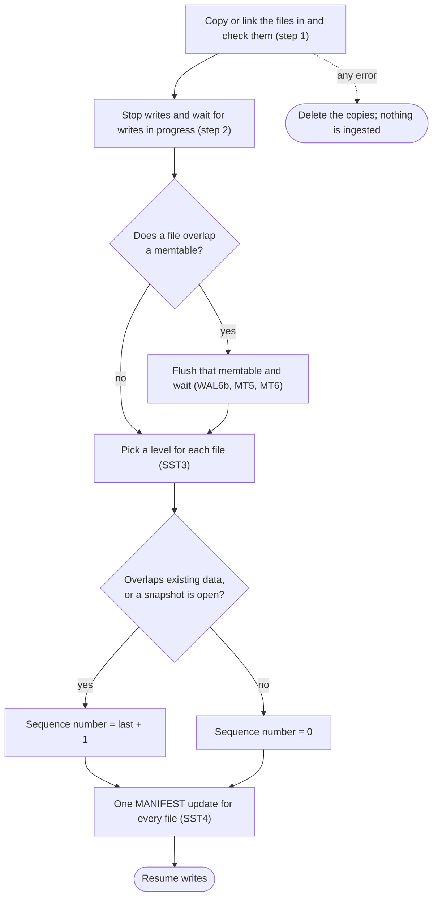

# MemTable, Column Families, and SST Files

## Reference

- [RocksDB wiki: MemTable](https://github.com/facebook/rocksdb/wiki/MemTable)
- [RocksDB wiki: Column Families](https://github.com/facebook/rocksdb/wiki/Column-Families)
- [RocksDB wiki: Creating and Ingesting SST files](https://github.com/facebook/rocksdb/wiki/Creating-and-Ingesting-SST-files)

## Problem
The main reason a key-value store built using an LSM tree splits its data between memory and disk is to ensure durability and speed. Updating each key in place on the disk would be a random write for each update which is extremely slow. So the key value store batches the writes as one large sorted file and writes it to the disk. This impacts the cost of reads as the key may be in memory or in any of the several files. 

The part of the data that is in memory is kept as a sorted buffer and is called the MemTable. Every new write goes into it, and every read checks it first, because it holds the newest data. When it is full (write_buffer_size, 64 MB by default), it is frozen. A frozen memtable takes no more writes but still answers reads. A new, empty memtable takes its place in the same step as the freeze, so there is always exactly one memtable taking writes.

The freeze does not happen the instant the memtable fills up. The write that fills it only marks it as full. The freeze happens at the start of the next write, before that write is logged. It also waits until every write already logged has been inserted into a memtable. Otherwise a late write could land in the new memtable, in front of a newer one.

The part of the data that is on the disk is a file of key–value pairs in key order which never changes once written and is called the SSTable. It has an index and a Bloom filter, so a lookup reads only a few blocks. Writing a frozen memtable to a new SST file is called a flush. New SST files go into level 0 (L0). Compaction later merges them into deeper levels L1, L2, and so on. An SST file can also be built outside the store and brought in directly. This is called ingestion. 

Each write gets a sequence number that says how new it is. Newer data always sits above older data. A read checks the memtable, then the frozen memtables, then L0, then each deeper level, and stops at the first version it finds. Compaction depends on the same rule.

A memtable lives in memory, so a crash would lose every write that has not been flushed yet. The write-ahead log (WAL) fixes this. Each write goes to a log file on disk before it goes into the memtable. If the store crashes, it replays the log to rebuild the memtables. Once a memtable has been flushed to an SST, its log records are no longer needed, and old log files can be deleted. The WAL is specified separately (algorithm/wal/wal.md). This file uses these of its steps:

| WAL step | What it does |
|---|---|
| WAL1 | Admits a write. At this point it checks whether a memtable is full, or all memtables are too big, and starts a freeze. |
| WAL4a | Inserts logged writes into the memtables (MT1). |
| WAL5 | Checks WAL pressure: if the live log files are over `max_total_wal_size`, it flushes the column families that hold the oldest log. |
| WAL6a | Freezes the chosen memtables (MT4) and starts a new log file. |
| WAL6b | Asks a background job to flush the frozen memtables (MT5). |
| WAL7a, WAL7b | Run just before and just after a flush is recorded in the MANIFEST (MT6). WAL7a syncs the old logs still needed; WAL7b marks the flush done. |
| WAL8a | Marks log files that no column family needs any more, so they can be deleted. |

## System Model

The LSM tree (T) holds everything for each column family: the active memtable, the frozen memtables, and the SST files. L0 files may overlap each other and are kept newest first. In L1 and deeper, the files of one level never overlap.

The MANIFEST is a file that records which column families and SST files exist, each column family's log number N_c, and the last sequence number used. Every change to it is written in one step, all or nothing, after the files it mentions are safely on disk.

A memtable (M) is a sorted buffer in memory. It can insert, look up a key, and say whether it is full or empty.

The WAL is the log described in algorithm/wal/wal.md.

## Memtable Life Cycle

Each column family has one active memtable at a time. A memtable goes through five stages:

1. **Active.** It takes new writes and answers reads.
2. **Frozen.** A flush was triggered. It takes no more writes, but still answers reads. A new, empty
   memtable becomes active in the same step, and the WAL starts a new log file (MT4, called from WAL6a).
3. **Flushing.** A background job is writing it to an SST file (MT5). If the write fails, the memtable
   goes back to Frozen and is tried again later.
4. **Waiting to install.** Its SST file is written, but older frozen memtables are not installed yet.
   Files are installed strictly oldest first.
5. **Installed.** Its SST file is now in L0, and the MANIFEST says so (MT6). The memtable is no longer
   needed. It is freed once no reader is using it.

Until the memtable is installed, reads still check it.

Two settings change this picture. If too many frozen memtables pile up (`max_write_buffer_number`),
new writes wait until a flush finishes. If `max_write_buffer_size_to_maintain` is set, some installed
memtables are kept in memory for a while instead of being freed.

## Flush Triggers

| Trigger | Detected by | What is flushed |
|---|---|---|
| A memtable is full (`write_buffer_size`) | MT3, asked by WAL1 at the start of the next write | that column family |
| All memtables together are over `db_write_buffer_size` | the write buffer manager, in WAL1 | the column family with the oldest memtable |
| The log files are over `max_total_wal_size` | WAL5 | every column family that needs the oldest log file |
| The user calls `Flush` | the user | the named column families |
| An ingested file overlaps a memtable | SST2 | that column family |

The wiki says the write buffer manager flushes the *largest* memtable. We believe the current RocksDB
code (`HandleWriteBufferManagerFlush`) flushes the *oldest* one, and this design follows that. This
should be checked against the RocksDB version being studied.

## Column Families

A column family is a separate key space inside one store. Every key belongs to exactly one. The
"default" column family always exists and cannot be dropped.

Column families share the WAL and the sequence numbers. They share nothing else. Sharing the WAL
makes a batch that writes to several column families atomic. Sharing sequence numbers gives
iterators over several column families one consistent view (CF5). Because memtables and files are
separate, each column family can be tuned, flushed, and dropped on its own.

Sharing the log has a cost. Any freeze, in any column family, starts a new log file for all of them.
A log file can be deleted only after every column family has flushed the writes in it. So a column
family that is rarely written keeps old log files alive, until WAL pressure forces it to flush.

When a column family is dropped, it stops taking writes and stops holding on to log files. Its data
stays readable through any handle that is still open. The data is deleted when the last handle is
released. A read-write open must list every column family in the store.

## Creating and Ingesting SST Files

`SstFileWriter` (SST1) builds a sorted SST file outside the store. Keys must be added in strictly
increasing order. Range deletions are the only exception. Every key in the file has sequence number 0.

Ingestion (SST2) brings one or more of these files into one or more column families. Either every file
goes in, or none does. The steps are:

1. Copy or link the files into the store and check them.
2. Stop new writes, and wait for writes already in progress to finish.
3. Flush any memtable whose keys fall inside a file's key range.
4. Pick a level for each file (SST3). It goes as deep as it fits, but never below a level that already
   has one of its keys.
5. Pick a sequence number for each file (SST3). If the file overlaps existing data, or a snapshot is
   open, it gets the next sequence number, so it is newer than what it overlaps. Otherwise it keeps 0.
6. Record every file in one MANIFEST update (SST4), then let writes resume.

With `ingest_behind`, a file goes to the bottom level with sequence number 0. Any existing version of a
key then wins over it.

## Algorithms 

T is the LSM tree, M a memtable,
c a column family, k a key, s a sequence number, F a file, and h a handle.

| Algorithm | Procedure | What it does |
|---|---|---|
| MT1 | `Insert(M, r)` | Adds a write to the memtable (called by WAL4a) |
| MT2 | `MemGet(M, k, s)` | Finds the newest version of a key in one memtable |
| MT3 | `ShouldFlush(M)`, `IsEmpty(M)` | Says whether the memtable is full, or empty |
| MT4 | `T.SealMutable(c, n)` | Freezes the memtable and starts a new one (called only by WAL6a) |
| MT5 | `T.FlushJob(c)` | Writes frozen memtables to an L0 SST file |
| MT6 | `T.InstallFlush(c)` | Installs finished flushes in order and moves N_c forward |
| MT7 | `T.Get(c, k, s)` | Reads a key: memtables first, then L0, then each level |
| CF1 | `T.CreateColumnFamily(c, opts)` | Creates an empty column family |
| CF2 | `T.DropColumnFamily(h)` | Drops a column family; its data stays readable until CF3 |
| CF3 | `T.ReleaseHandle(h)` | Deletes a dropped column family's data when the last handle goes |
| CF4 | `Open(dir, descs)` | Opens the store; read-write opens must list every column family |
| CF5 | `T.NewIterators(H, s)` | Iterates several column families at the same point in time |
| SST1 | `SstFileWriter` | Writes an SST file outside the store |
| SST2 | `T.IngestExternalFiles(args)` | Ingests files into one or more column families, all or nothing |
| SST3 | `T.AssignLevelAndSeqno(c, F, s)` | Picks a file's level and sequence number |
| SST4 | `T.CommitIngestion(placed)` | Records every ingested file in one MANIFEST update |

## Invariants

The invariants are named MS1 to MS7

- **MS3** In the order a read checks things (memtable, frozen memtables, L0
  newest first, then L1, L2, ...), a later place never holds a newer version of a key than an earlier
  place. Compaction relies on this when it merges files as it keeps the version with the highest
  sequence number. If this rule broke, a merge could keep an old value. 
- **MS6** In L1 and deeper, files in the same level never overlap. Compaction relies on
  this to pick its input files by key range. 
- **MS7** N_c never moves past a log file that an unflushed memtable of c still
  needs. This decides which log files stay live. Live log files count toward `max_total_wal_size`, so
  this decides when WAL pressure forces small, early flushes, and so when small L0 files appear. 

The other four invariants are about what readers see, and they do not change the files compaction
receives. A read returns the latest committed value (MS1). A snapshot keeps showing what was committed
when it was taken (MS2). A batch across column families is visible in all of them or in none (MS4). An
ingestion lands in all of its column families or in none (MS5).

## Underspecifications in the wiki

(a) The wiki says a full memtable "becomes immutable and replaced by a new memtable", but never says when, or that the swap must wait for writes still being inserted. MT4 runs only from WAL6a, at the start of the next write, after every logged write is in its memtable. Without the wait, a late write lands in the new memtable behind a newer one, and a read returns the old value.

(b) The wiki says a background thread flushes the memtable, but never says in what order finished flushes are installed. MT6 installs them strictly oldest first, so a newer flush waits for an older one. Without this, N_c moves past a log file that an older, still unflushed memtable needs, and once that log is deleted a crash loses its writes.

(c) The wiki says reads check the memtable before SST files, but never says how long a frozen memtable keeps answering reads. MT7 keeps reading it until MT6 has installed its SST file in L0, not just written it. Without this, there is a moment when the data is in neither place a reader looks, and a read misses it.

(d) The wiki says that when all memtables together pass db_write_buffer_size, "the largest memtable will be flushed", while the RocksDB code (HandleWriteBufferManagerFlush) seems to flush the column family with the oldest memtable. Our spec follows the code: WAL1 asks the write buffer manager for the oldest one and freezes it through MT4. Both choices are safe, but they free memory at different speeds and produce different L0 files, so a reader of the wiki predicts the wrong flushes. (unchecked)

(e) The wiki says an old log file can be deleted only when all column families have flushed its data, but never says how the store knows which logs a column family still needs. MT6 moves the column family's log number N_c forward in the same MANIFEST update that installs the flush. If the two are saved separately, a crash in between either deletes a log whose writes are in no SST file, or replays writes that are already in one.

(f) The wiki says a dropped column family's data is deleted only when its last handle is released, but never says whether, until then, it keeps old log files alive or still gets flushed. CF2 stops counting the dropped column family when finding the oldest log to keep, and never flushes it again. Without this rule, one dropped column family can keep every log file alive and hold WAL pressure high until the handle is released. (unchecked)

(g) The wiki says ingestion flushes the memtable if the file's key range overlaps it, but never says that frozen memtables count too, or that ingestion must wait until the flush is installed. SST2 freezes and flushes every overlapping memtable through WAL6a and WAL6b, and waits for MT6 before it picks a level. Without this, the ingested file lands below an older value still in memory, and a read returns the old value.

(h) The wiki says the ingested file gets a global sequence number, but never says which one. SST3 gives it the next sequence number if it overlaps existing data or a snapshot is open, and 0 otherwise. Without this rule, the file can look older than the data it replaces, so a read returns the old value, or a snapshot taken before the ingestion starts to see the new file.

(i) The wiki says writes are blocked during ingestion so the right sequence number can be picked, but never says the block must also wait for writes already in progress. SST2 waits until every logged write is visible to readers before SST4 commits. Without the wait, readers can see part of a batch that spans several column families, so the batch is not all or nothing.

(j) The wiki says IngestExternalFiles is all or nothing across column families, but never says how. SST4 records every file in one MANIFEST update, and readers see all of them at the same moment. Without this, a crash or a reader can find the files in some column families but not in others
