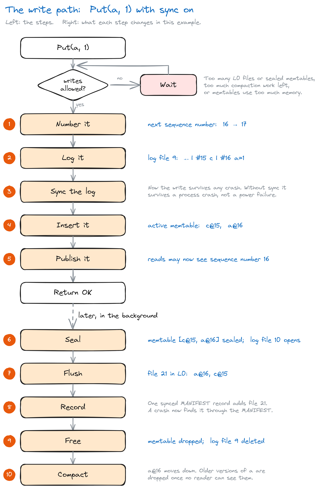
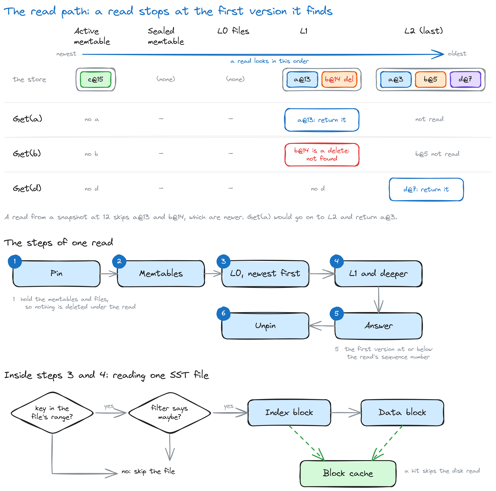

# The RocksDB Store

## Reference

- RocksDB wiki: [Write Stalls](https://github.com/facebook/rocksdb/wiki/Write-Stalls),
  [MANIFEST](https://github.com/facebook/rocksdb/wiki/MANIFEST),
  [Delete Stale Files](https://github.com/facebook/rocksdb/wiki/Delete-Stale-Files),
  [Creating and Ingesting SST files](https://github.com/facebook/rocksdb/wiki/Creating-and-Ingesting-SST-files),
  [Compaction](https://github.com/facebook/rocksdb/wiki/Compaction)

  ## The Store at a Glance

RocksDB is a key–value store. An application puts and deletes keys, reads them back, and can hand
the store a whole sorted file built elsewhere. The picture shows every part of the store and how
data moves between them.


The parts, from top to bottom:

- The **write controller** decides whether a write may go on now, must slow down, or must wait.
- The **memtable** is a sorted buffer in memory that takes new writes. When it is full it is
  **sealed**: it becomes read-only, and a new memtable takes the next writes.
- The **write buffer manager** limits how much memory all memtables may use together.
- The **block cache** keeps recently read pieces of files in memory, so reads are fast.
- The **write-ahead log** (WAL) is a file on disk that records every write in order, so a crash
  loses nothing that was synced. Every write gets a **sequence number**, and a newer version of a
  key always has a larger one.
- The **LSM tree** holds the data on disk in **SST files**, sorted files that never change. L0 holds
  the newest files, one per flush. Each deeper level holds older data in larger files.
- The **MANIFEST** is a log on disk that says which files make up the tree. After a crash, the store
  rebuilds the tree from it.
- Three **background jobs** keep the store in shape. A **flush** writes a sealed memtable to a new
  L0 file. A **compaction** merges files and moves data down the tree. The **file purge** deletes
  files that are no longer used.

Each part was specified on its own earlier. This folder puts them together and checks what only the
whole store can get right.

## The Write Path

A write is short. The application waits for a check and five steps. Everything after that happens later, in
the background. The picture follows one write, `Put(a, 1)` with sync on, into a store whose last
sequence number is 15.



First the write controller lets the write in, unless the store is behind. It makes the write wait
when there are too many L0 files or sealed memtables, when compaction has too much work left, or
when the memtables use too much memory. Then come the five steps in the picture:

1. **Number it.** The write takes sequence number 16.
2. **Log it.** It is appended to the current log file.
3. **Sync the log.** If the application asked for it, the log file is forced to disk. From now on
   the write survives a power failure. Without sync, it survives a process crash but not a power
   failure.
4. **Insert it.** The write goes into the active memtable as `a@16`.
5. **Publish it.** Reads may now see sequence number 16. The application gets OK.

Later, the memtable fills up and is sealed, and a new log file starts. A flush writes the sealed
memtable to a new L0 file and syncs it. One MANIFEST record then adds the file to the tree. Only
after that record is on disk may the store drop the memtable and delete the log file, because the
data now lives in the tree. Compaction then moves `a@16` down, level by level, and drops older
versions of `a` once no reader can see them.

## The Read Path

A read looks in the newest place first, and stops at the first version of the key it finds. The
picture runs three reads against a small store. The memtable holds `c@15`. L1 holds `a@13` and a
delete of `b` at 14. L2, the last level, holds `a@3`, `b@5`, and `d@7`.



- `Get(a)` misses the memtables and L0, finds `a@13` in L1, and never reads L2.
- `Get(b)` finds the delete of `b` in L1 and returns "not found". The older `b@5` is hidden.
- `Get(d)` finds nothing above and reaches `d@7` in L2.

A read first **pins** what it reads: it takes its sequence number and holds on to the current
memtables and files, so nothing it needs is deleted under it. It reads the active memtable, then
the sealed ones, then every L0 file whose key range holds the key, newest first. In L1 and below the
files of a level do not overlap, so at most one file per level can hold the key. Inside a file, the
read checks the key range and the filter first and skips the file if the key cannot be there.
Otherwise it reads the index block, then the data block, each through the block cache. A read from
a snapshot works the same way but ignores versions newer than the snapshot: at snapshot 12,
`Get(a)` would skip `a@13` and return `a@3`.

## The Compaction Job, Step by Step

A compaction job does its work in four steps.

1. **Pick.** The compaction style chooses the input files. The job notes the next file number,
   so that the purge will not delete the files it is about to write.
2. **Merge and write.** The job merges the inputs and writes new files, each synced. These files
   are on disk, but the tree does not list them yet.
3. **Install.** One MANIFEST record removes the inputs and adds the new files. The record is synced
   first. Only then does the tree in memory change.
4. **Purge.** The old input files are deleted once no reader is still using them.

A crash before the record is synced leaves the old tree whole on disk. The new files are orphans,
and the next open deletes them. A crash after the sync keeps the new tree. Either way only work is
lost, never data.

## Problem

Each part was specified on its own, with the others as its surroundings. Most mistakes, though,
happen where the parts meet, and compaction meets almost all of them. Here is what can go wrong in
the whole store.

- **File numbers.** Compaction writes its new files before the MANIFEST lists them. A purge that
  scans the disk could take them for leftovers and delete them.
- **The MANIFEST.** If the tree in memory changes before the record is on disk, the purge may delete
  files that the MANIFEST on disk still needs after a crash.
- **Sequence numbers.** If a number were handed out twice after a crash, two versions of a key
  would tie, and compaction would keep one of them at random.
- **Ingestion.** An external file is durable the moment it is recorded. If older writes still sit
  in an unsynced log, a power failure keeps the newer file and loses the older writes.
- **Write stalls.** A stall on too many L0 files ends only when compaction runs. If compaction is
  off, or not yet due, writes stop forever.

This folder specifies the whole store as one data structure, states the rules that prevent each of
these, and checks the rules with a TLA+ model and with the C++ code.

## The Data Structure

```
Data structure RocksDBStore
    tree             : LSMTree              memtables and the version (files per level)
    policy           : Policy               leveled or universal compaction, with its options
    config           : Configuration        the options, sanitized at open
    job              : CompactionJob        the running compaction (or none)

    wal              : WAL                  the log files and how far they are synced
    manifest         : Manifest             the durable record of the version
    bufferManager    : WriteBufferManager   memtable memory; may be shared with other stores
    blockCache       : BlockCache           file blocks in memory; may be shared

    persistedThrough : Integer              every logged write and ingestion up to here survives any crash

    nextSeq          : ℕ                    next sequence number
    nextMemId        : ℕ                    next memtable id (also the number of the log it starts)
    nextFileId       : ℕ                    next file number, for SST files and logs alike
    nextRunId        : ℕ                    next epoch: the age order of L0 files and sorted runs

    accepting        : Boolean              writes may go on
```

The first four fields are the tree and how it is reshaped. The next four are the other parts in the
architecture picture. `persistedThrough` says how much of the history is safe: every write up to
that sequence number survives any crash. The four counters hand out fresh numbers. `accepting` is
the write controller's answer.

A **job** records its input files, its output level, the snapshots it saw when it started, the
file number it noted when it started (`minOut`), and the files it has written (`outs`). RocksDB may
run several jobs at once. The store here holds one; the LSM tree specification shows how several
stay apart. **Pending outputs** are the file numbers noted by running jobs. A flush or compaction
job adds `nextFileId` when it starts and removes it when its record is applied.

## How It Fits the Other Specifications

Each part in the architecture picture has its own specification. This one reuses them as they are.

| Part | Folder | Steps |
|---|---|---|
| Write-ahead log | `wal/` | WAL1 to WAL9 |
| Memtables, column families, SST files, ingestion | `memtable_sst/` | MT1 to MT7, CF1 to CF5, SST1 to SST4 |
| Write buffer manager | `write_buffer/` | WBM1 to WBM9 |
| Block cache | `block_cache/` | BC1 to BC11 |
| LSM tree and compaction | `lsm_tree/` | LSM1 to LSM12 |
| The whole store: counters, durability, stalls | here | DB0 to DB11 |

The parts talk to each other through rules called contracts, numbered K1 to K13 in the earlier
specifications. The whole store adds five more, one for each problem listed above:

- **(K14) Protect new files.** A flush or compaction job notes the next file number when it starts.
  Until its MANIFEST record is applied, a purge keeps every file numbered at or above it.
- **(K15) One synced record per change.** Every change to the tree is one MANIFEST record. It is on
  disk before the tree in memory changes. It also carries the last sequence number and the next file
  number.
- **(K16) Stop writes only if something will restart them.** Too many L0 files, or too much work
  left, stops writes only when automatic compaction is on, and only once a compaction is due.
- **(K17) Start past everything.** After a crash, the counters start past every file on disk and
  past every sequence number in the MANIFEST and the logs.
- **(K18) Sync the log before ingesting.** Ingestion syncs the write-ahead log before it records
  the external file.

## Algorithms

| Algorithm | Procedure | What it does |
|---|---|---|
| DB0 | `RocksDBStore` | The data structure above |
| DB1 | `Open(θ)` | Sanitize the options, read the MANIFEST, set the counters past everything on disk, replay the WAL, delete orphans, new cache session |
| DB2 | `Write(b, sync)` | Wait for `accepting`, number, log, sync if asked (moves `persistedThrough`), insert, publish |
| DB3 | `Get(c, k, snap)` | Read the memtables, then the files, through the block cache |
| DB4 | `Flush(c)` | Memtables to one L0 file, protected as a pending output, one record |
| DB5 | `PickCompaction()` | Pick inputs by the policy, capture `minOut` |
| DB6 | `RunCompactionJob(j)` | Merge and write the outputs, synced, in no version yet |
| DB7 | `InstallCompaction(j)` | One record, synced, then the new version |
| DB8 | `PurgeObsoleteFiles(full)` | Delete files no live version lists, but keep pending outputs |
| DB9 | `IngestExternalFile(c, F)` | Stop writes, flush an overlapping memtable, sync the WAL, place the file, one record |
| DB10 | `UpdateWriteStall()` | Set `accepting`; stop only where a background job can end the stop |
| DB11 | `Close()` | Stop the job, flush log buffers, release the shared parts |

## Invariants

An invariant is a rule that must hold at every moment, whatever runs and whenever a crash comes.
Five of them are about the whole store:

- **ST1, a crash keeps a prefix.** After any crash, the store holds exactly the writes up to some
  point in time, and that point is at or after `persistedThrough`.
- **ST2, the MANIFEST's files exist.** Every file the MANIFEST on disk lists is on disk.
- **ST3, a job's new files exist.** Every file a running job has written stays on disk until the
  job's record is applied.
- **ST4, sequence numbers are fresh.** The next sequence number is larger than every sequence
  number in the store.
- **ST5, a stop ends.** If writes are stopped, they start again later, as long as the background
  jobs run.

Compaction keeps ST1 because nothing on disk changes until its one record is synced, and that
record only replaces versions by equal or newer ones. ST2 and ST3 are why the record is synced
before the purge runs, and why new files are protected. ST4 matters because compaction keeps the
newest version of a key by its sequence number. ST5 matters because only compaction ends an L0
stop.

Three more rules are bookkeeping. **ST6:** every number in use is below the counter that hands it
out. **ST7:** `accepting` is true exactly when writes are not stopped. **ST8:** the memtables stay
within the write buffer manager's limit. The parts' own invariants hold as before: the WAL's I1 to
I5, MS1 to MS7, BM1 to BM6, CH1 to CH8, and LS1 to LS7. The TLA+ model checks LS1, LS2, LS3, and
LS6 together with ST1 to ST8.