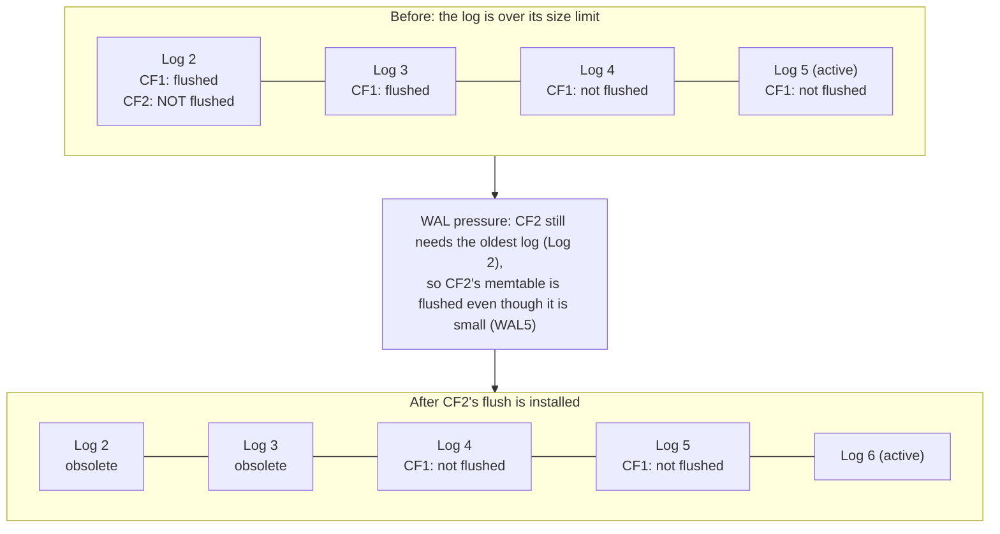
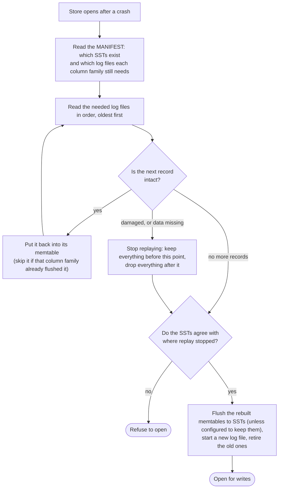

# Write-Ahead Log (WAL)

## Reference

[RocksDB wiki: Write-Ahead Log (WAL)](https://github.com/meta/rocksdb/wiki/Write-Ahead-Log-%28WAL%29)

## Problem

A key–value store built as an LSM tree keeps its most recent writes in memory, in a sorted
structure called a memtable. When the process crashes or the machine loses power, every write
the store has accepted but not yet copied to disk would be lost.

The write-ahead log fixes this by ensuring that before a write goes into the memtable, it
is appended to a log file on disk. From time to time a full memtable is written to disk as a sorted
file called an SST. Once every write in a log file is safely in an SST, that log file is no longer
needed and can be deleted.

Compaction never touches the log directly, but the log decides when memtables are flushed, how big
the resulting files are, and when writers are slowed down. Those decisions shape the work compaction
receives, so the specification keeps every WAL behavior that changes them.

## Tracking the path of a single write

(a) The client submits a write which waits in a queue. If the store is overloaded, it is slowed down or
rejected. Otherwise it is admitted (Algorithm WAL1).

(b) The write gets a sequence number, which fixes its place in the global order, and is appended to the
current log file (Algorithm WAL2).

(c) The log bytes are pushed to the operating system and, if the client asked for it, forced onto the
disk (Algorithm WAL3a and WAL3b).

(d) The write is inserted into the memtable and then made visible to readers, and the client receives
the response (Algorithm WAL4a and WAL4b).

(e) When the memtable is full or the shared log has grown past its size limit, a flush is triggered
(Algorithm WAL5).

(f) The memtable is frozen, a fresh one takes its place, and a new log file is started at the same
moment (Algorithm WAL6a and WAL6b).

(g) A background job writes the frozen memtable to disk as an SST file.

(h) The SST is installed, and the WAL syncs the closed log files just before and records the progress
just after (Algorithm WAL7a and WAL7b).

(i) Once no column family needs the old log file, it is marked obsolete and later deleted, archived,
or recycled (Algorithm WAL8a and WAL8b).

(j) If the machine crashes at any point, the store replays the log files that are still needed to
rebuild the memtables (Algorithm WAL9).

## System Model

The WAL is one module among several. The specification treats the others as black boxes with
their own algorithms, and the WAL uses them only through a small set of operations. This
keeps the WAL specification short and lets any correct implementation of the other modules
be plugged in.

The **LSMTree** (written T) is the store itself. It owns the memtables, the SST files, and the
MANIFEST, which is the durable record of which SSTs exist. It also remembers, for each
column family, the oldest log file that family still needs. The WAL asks it questions such as
"which memtable is current for this column family?" and gives it commands such as "freeze
this memtable" and "schedule a flush".

A **MemTable** is the in-memory sorted buffer. The WAL only inserts into it, asks whether it is
full, and asks whether it is empty.

An **SSTable** is an on-disk sorted file. The WAL never builds one. It only asks, during recovery,
for the largest sequence number an SST contains.

The **WriteBufferManager** (written B) watches the total memory used by all memtables. It can ask
for a flush when memory is tight, and it can ask writers to stall.

The **BlockCache** caches file blocks for reads. The WAL does not use it at all.

For the WAL to be correct, the other modules must keep four promises:

- **(K1)** A memtable is frozen only by the WAL, so that every freeze also starts a new log file.
- **(K2)** When the LSM tree installs a flushed SST, it records in the same MANIFEST update which log
  files that column family no longer needs.
- **(K3)** The LSM tree calls the WAL just before and just after each installation.
- **(K4)** The SST files and the MANIFEST update are written durably and all at once.

## WAL State

The WAL keeps only a small amount of state of its own, written W = (L, a, Q, D, F, θ). Everything else,
such as the memtables, the SST files and each column family's oldest needed log file, belongs to the
LSM tree and is read through its interface.

- **L, the log files.** The list of log files in order. For each file the WAL tracks how far it has been
  appended, pushed to the operating system, and forced onto disk, whether its directory entry is on
  disk, its size, and its state in the life cycle below.
- **a, the active log file.** The one file that receives new writes.
- **Q, the writes in flight.** Every write that has been submitted but not yet answered, together with
  how far it has got: queued, admitted, numbered, logged, inserted into the memtable, or visible to
  readers.
- **D, the writes that are safely in SSTs.** Used only to state and prove correctness; the real store
  tracks this through each column family's oldest needed log file.
- **F, the flush requests.** For each request, the column family, why it was asked for (memtable full,
  memory pressure, WAL size limit, manual, or recovery), and whether it is waiting, scheduled, or done.
- **θ, the configuration.** The RocksDB options that change WAL behavior, such as the WAL size limit,
  the write mode, and the recovery mode.

## Log Life Cycle

A log file is created when the store opens or when a memtable is frozen, and it becomes the active
file that receives every new write from every column family. When the next memtable is frozen, a new
file takes over and this one is closed, so nothing more is ever written to it. A closed file is kept
as long as some column family still has unflushed writes in it or in an older file. Once every column
family has flushed past it, it is marked obsolete because recovery will never need it again. A
background cleanup then deletes it, archives it, or keeps it for reuse as a future log file. Only
active and closed files count toward the WAL size limit, while obsolete, archived and recycled files
still use disk until they are deleted.

## WAL Pressure with a Shared Log

All column families write into the same log files, so one log file can hold writes from several of
them, and it can only be retired when every one of them has flushed. A column family that is written
rarely therefore keeps old log files alive while the others keep adding new ones. When the active and
closed log files together grow past the WAL size limit, the store finds the oldest live log file and
flushes every column family that still needs it, even if that memtable is nearly empty (Algorithm
WAL5). Once that flush is installed, the oldest log files are no longer needed and are retired. This
rule only applies when there is more than one column family, and it produces small, early L0 files
that compaction then has to handle.

## Recovery

When the store opens after a crash, it reads the MANIFEST to learn which SST files exist and which
log files each column family still needs. It then reads those log files in order, oldest first, and
puts each write back into its memtable, skipping any write whose column family had already flushed
it. In the default point-in-time mode, replay stops at the first damaged or missing record, so the
store keeps everything before that point and drops everything after it. Before opening, it checks
that no SST already holds data from beyond the stopping point, and refuses to open if one does.
Finally, it flushes the rebuilt memtables to SSTs (unless configured to keep them in memory), starts
a new log file, retires the old ones, and opens for writes (Algorithm WAL9).

## WAL Algorithms

| Algorithm | Procedure | What it does |
|---|---|---|
| WAL1 | `Admit(G; T, B)` | Runs any due flush, waits out stalls, admits a write group |
| WAL2 | `AppendGroup(G)` | Assigns sequence numbers and appends the group as one log record |
| WAL3a | `FlushWAL(ℓ)` | Pushes log bytes to the operating system |
| WAL3b | `SyncWALs()` | Forces every live log file, and its directory entry, onto disk |
| WAL4a | `InsertGroup(G; T)` | Inserts the group into the memtables, marks full memtables |
| WAL4b | `PublishGroup(G)` | Makes the group visible to readers and answers the clients |
| WAL5 | `CheckWALPressure(; T)` | Forces a flush when the shared log is over its size limit |
| WAL6a | `SwitchMemtable(S; T)` | Freezes memtables and starts a new log file |
| WAL6b | `RequestFlush(S, cause; T)` | Freezes memtables and schedules their flush, recording the cause |
| WAL7a | `BeforeFlushInstall(S; T)` | Syncs closed log files before a flush is installed |
| WAL7b | `AfterFlushInstall(S, mems; T)` | Records a completed flush and retires logs |
| WAL8a | `MarkObsolete(; T)` | Marks closed log files below MinLogToKeep obsolete |
| WAL8b | `DisposeLog(ℓ)` | Archives, recycles, or deletes an obsolete log file |
| WAL9 | `Recover(θ; T)` | Replays the needed log files after a crash |
