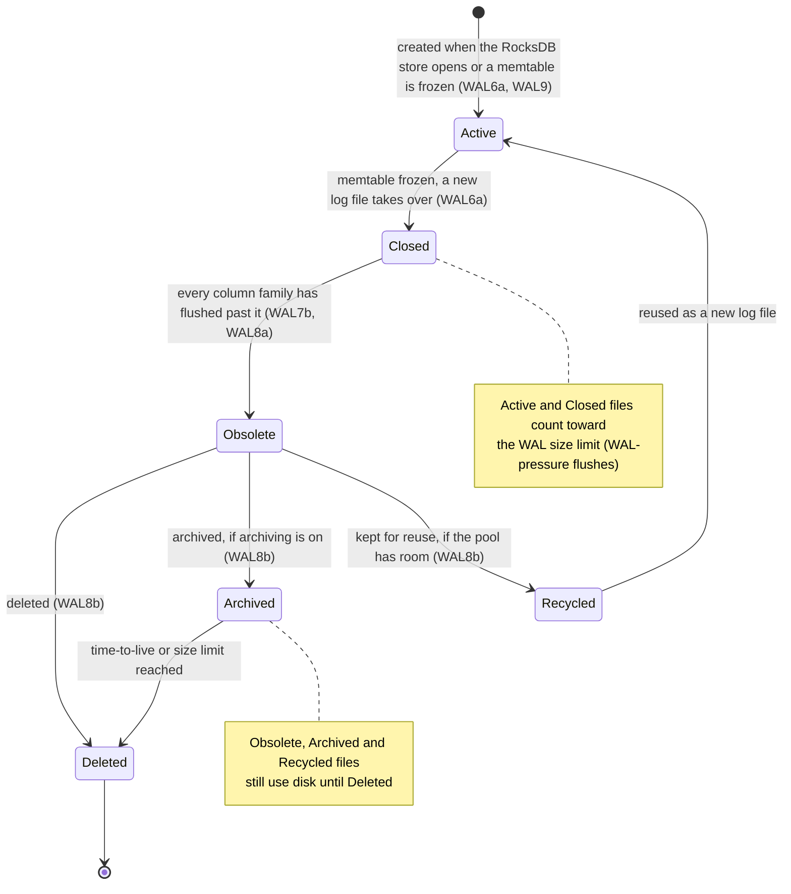
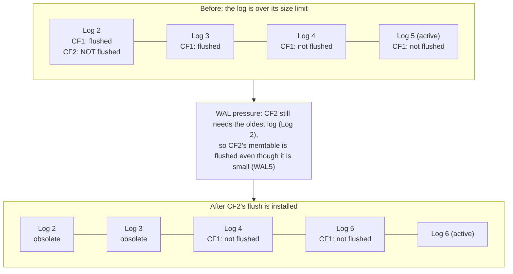
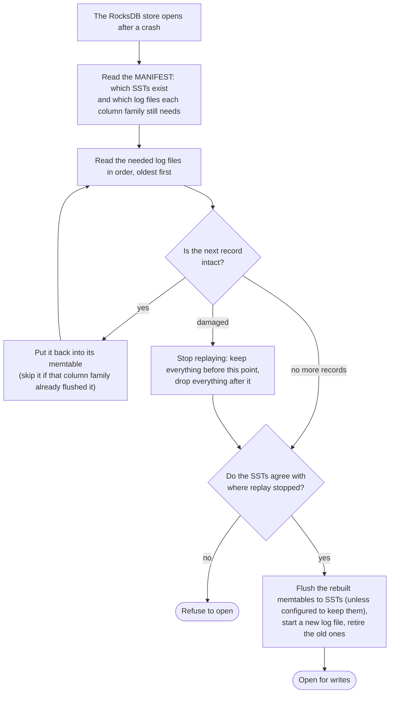

# Write-Ahead Log (WAL)

## Reference

[RocksDB wiki: Write-Ahead Log (WAL)](https://github.com/facebook/rocksdb/wiki/Write-Ahead-Log-%28WAL%29)

## Problem

A key–value store built as an LSM tree keeps its most recent writes in memory, in a sorted
structure called a memtable. When the process crashes or the machine loses power, every write
the RocksDB store has accepted but not yet copied to disk would be lost.

The write-ahead log fixes this by ensuring that before a write goes into the memtable, it
is appended to a log file on disk. From time to time a full memtable is written to disk as a sorted
file called an SST. Once every write in a log file is safely in an SST, that log file is no longer
needed and can be deleted.

Compaction never touches the log directly, but the log decides when memtables are flushed, how big
the resulting files are, and when writers are slowed down. Those decisions shape the work compaction
receives, so the specification keeps every WAL behavior that changes them.

## Tracking the path of a single write

(a) The client submits a write which waits in a queue. If the RocksDB store is overloaded, it is slowed down or
rejected. Otherwise it is admitted (Algorithm WAL1).

(b) The write gets a sequence number, which fixes its place in the global order, and is appended to the
current log file (Algorithm WAL2).

(c) The log bytes are pushed to the operating system and, if the client asked for it, forced onto the
disk (Algorithm WAL3a and WAL3b).

(d) The write is inserted into the memtable and then made visible to readers, and the client receives
the response (Algorithm WAL4a and WAL4b).

(e) When the memtable is full, or the write buffer manager says memtables use too much memory, a flush is triggered (Algorithm WAL1). When the
shared log has grown past its size limit, a flush is triggered too (Algorithm WAL5).

(f) The memtable is frozen, a fresh one takes its place, and a new log file is started at the same
moment (Algorithm WAL6a). Then a flush of the frozen memtable is scheduled (Algorithm WAL6b).

(g) A background job writes the frozen memtable to disk as an SST file.

(h) The SST is installed, and the WAL syncs the closed log files just before and records the progress
just after (Algorithm WAL7a and WAL7b).

(i) Once no column family needs the old log file, it is marked obsolete and later deleted, archived,
or recycled (Algorithm WAL8a and WAL8b).

(j) If the machine crashes at any point, the RocksDB store replays the log files that are still needed to
rebuild the memtables (Algorithm WAL9).

## System Model

The WAL is one module among several. The specification treats the others as black boxes with
their own algorithms, and the WAL uses them only through a small set of operations. This
keeps the WAL specification short and lets any correct implementation of the other modules
be plugged in.

The **LSMTree** (written T) is the data structure of the RocksDB store. It owns the memtables, the SST files, and the
MANIFEST, which is the durable record of which SSTs exist. It also remembers, for each
column family, the oldest log file that family still needs. The WAL asks it questions such as
"which memtable is current for this column family?" and gives it commands such as "freeze
this memtable" and "schedule a flush".

A **MemTable** is the in-memory sorted buffer. The WAL only inserts into it, asks whether it is
full, and asks whether it is empty.

An **SSTable** is an on-disk sorted file. The WAL never builds one. It only asks, during recovery,
for the largest sequence number an SST contains.

The **WriteBufferManager** (written B) watches the total memory used by all memtables, across every
column family of one or more stores. It keeps two counts: u, the memory of every memtable not yet
freed, and a, the part of it in memtables that still take writes. β is its limit. WAL1 asks it three
things:

- `B.ShouldFlush()`: true when a > 7β/8, or when u ≥ β and a ≥ β/2.
- `B.PickVictims(T)`: the column family to flush. By default it is the one whose mutable memtable is
  oldest, skipping empty memtables and column families already being flushed.
- `B.StallState()`: Stop when `allow_stall` is on and u ≥ β, or a stall is already on; Go otherwise.

The memtables keep B's counts right: they report each new arena allocation, each seal, and each
destroy (contracts K5 to K7, in the [write buffer manager README](../../write_buffer/README.md)).

The **BlockCache** caches file blocks for reads. The WAL does not use it at all.

For the WAL to be correct, the other modules must keep four promises:

- **(K1)** A memtable is frozen only by the WAL, so that every freeze also starts a new log file.
- **(K2)** When the LSM tree installs a flushed SST, it records in the same MANIFEST update which log
  files that column family no longer needs.
- **(K3)** The LSM tree calls the WAL just before and just after each installation.
- **(K4)** The SST files and the MANIFEST update are written durably and all at once.

## WAL State

The WAL keeps only a small amount of state of its own, written W = (L, a, Q, D, F, θ). Everything else,
such as the memtables, the SST files and each column family's oldest needed log file, belongs to the
LSM tree and is read through its interface.

- **L, the log files.** The list of log files in order. For each file the WAL tracks how far it has been
  appended, pushed to the operating system, and forced onto disk, whether its directory entry is on
  disk, its size, and its state in the life cycle below.
- **a, the active log file.** The one file that receives new writes.
- **Q, the writes in flight.** Every write that has been submitted but not yet answered, together with
  how far it has got: queued, admitted, numbered, logged, inserted into the memtable, or visible to
  readers.
- **D, the writes that are safely in SSTs.** Used only to state and prove correctness; the real RocksDB store
  tracks this through each column family's oldest needed log file.
- **F, the flush requests.** For each request, the column family and whether it is requested or
  committed (the flush is saved in the MANIFEST).
- **θ, the configuration.** The RocksDB options that change WAL behavior, such as the WAL size limit,
  the write mode, and the recovery mode.

## Log Life Cycle

A log file is created when the RocksDB store opens or when a memtable is frozen, and it becomes the active
file that receives every new write from every column family. When the next memtable is frozen, a new
file takes over and this one is closed, so nothing more is ever written to it. A closed file is kept
as long as some column family still has unflushed writes in it or in an older file. Once every column
family has flushed past it, it is marked obsolete because recovery will never need it again. A
background cleanup then deletes it, archives it, or keeps it for reuse as a future log file. Only
active and closed files count toward the WAL size limit, while obsolete, archived and recycled files
still use disk until they are deleted.

## WAL Pressure with a Shared Log

All column families write into the same log files, so one log file can hold writes from several of
them, and it can only be retired when every one of them has flushed. A column family that is written
rarely therefore keeps old log files alive while the others keep adding new ones. When the active and
closed log files together grow past the WAL size limit, the RocksDB store finds the oldest live log file and
flushes every column family that still needs it, even if that memtable is nearly empty (Algorithm
WAL5). Once that flush is installed, the oldest log files are no longer needed and are retired. This
rule only applies when there is more than one column family, and it produces small, early L0 files
that compaction then has to handle.

## Recovery

When the RocksDB store opens after a crash, it reads the MANIFEST to learn which SST files exist and which
log files each column family still needs. It then reads those log files in order, oldest first, and
puts each write back into its memtable, skipping any write whose column family had already flushed
it. In the default point-in-time mode, replay stops at the first damaged record, so the
RocksDB store keeps everything before that point and drops everything after it. Before opening, it checks
that no SST already holds data from beyond the stopping point, and refuses to open if one does.
Finally, it flushes the rebuilt memtables to SSTs (unless configured to keep them in memory), starts
a new log file, retires the old ones, and opens for writes (Algorithm WAL9).

## WAL Algorithms

The end-to-end WAL algorithm is in WALFullAlgorithm.pdf. It calls each of the smaller algorithms below,
and each call links to its algorithm.

| Algorithm | Procedure | What it does |
|---|---|---|
| WAL1.pdf | `Admit(G; T, B)` | Runs any due flush, waits out stalls, admits a write group |
| WAL2.pdf  | `AppendGroup(G)` | Assigns sequence numbers and appends the group as one log record |
| WAL3a.pdf  | `FlushWAL(a)` | Pushes log bytes to the operating system |
| WAL3b.pdf  | `SyncWALs()` | Forces every live log file, and its directory entry, onto disk |
| WAL4a.pdf  | `InsertGroup(G; T)` | Inserts the group into the memtables |
| WAL4b.pdf  | `PublishGroup(G)` | Makes the group visible to readers and answers the clients |
| WAL5.pdf  | `CheckWALPressure(; T)` | Forces a flush when the shared log is over its size limit |
| WAL6a.pdf  | `SwitchMemtable(S; T)` | Freezes memtables and starts a new log file |
| WAL6b.pdf  | `RequestFlush(S; T)` | Schedules a flush of the frozen memtables |
| WAL7a.pdf  | `BeforeFlushInstall(S; T)` | Syncs closed log files before a flush is installed |
| WAL7b.pdf  | `AfterFlushInstall(S; T)` | Records a completed flush |
| WAL8a.pdf  | `MarkObsolete(; T)` | Marks closed log files below MinLogToKeep obsolete |
| WAL8b.pdf  | `DisposeLog(ℓ)` | Archives, recycles, or deletes an obsolete log file |
| WAL9.pdf | `Recover(θ; T)` | Replays the needed log files after a crash |
## Document underspecification in the Wiki:

(a) The wiki never says that every logged write must reach its memtable before that memtable is frozen and a new log starts. WAL5 waits until every logged write is in its memtable, and only then calls SwitchMemtable. Without the wait, a write can be in the old log but land in the new memtable; once the old log is deleted, a crash loses a write the client was told was saved.

(b) The wiki never says that, with several column families, the older closed logs must be on disk before a flush is saved in the MANIFEST. WAL7a forces every closed log that is still needed onto disk just before the flush is saved. Without it, a power failure can leave one column family holding a batch that the other column families have lost, which breaks the promise that a batch is all or nothing.

(c) The wiki never says that a frozen memtable is tagged with the new log’s number, or that the column family’s log number changes in the same MANIFEST edit as the flush. WAL6a tags each frozen memtable with num(a), and WAL7b requires that the same MANIFEST save set the column family’s log number to that tag. If the two are saved separately, a crash in between either deletes logs whose writes are in no SST file (lost writes) or replays writes already in an SST file (merge operands applied twice).

(d) The wiki names max_total_wal_size but doesn’t say when it applies or which column families it flushes. WAL5 acts only with more than one column family, acts once per oldest log, and flushes every column family whose log number is at or below that log’s number, even if their memtables are small. Without this, users can’t predict when flushes happen: the logs can grow without limit, or a burst of tiny L0 files can cause extra compaction and write stalls.

(e) The wiki doesn’t separate passing log bytes to the OS from forcing them to disk, and it doesn’t say what happens when either fails. WAL3a passes bytes to the OS, and WAL3b forces them to disk and syncs the log directory once per log; any failure sets bgError, which stops all writes and is never retried. Without this, an implementation can tell a client a write is safe when it is only in the OS cache, lose a whole new log file because the directory was never synced, or retry a failed sync that falsely reports success; in each case a power failure loses acknowledged writes.

(f) The WAL pages don’t explain the difference between a Delay and a Stop, or what happens to noSlowdown writes. WAL1 sleeps once under Delay, waits under Stop until neither T nor B says Stop, and in both cases fails noSlowdown writes with Incomplete. Without this, applications can’t predict write latency, and a client that asked never to wait may block anyway.

(g) The wiki doesn’t say that a write is replayed only if it is not yet in an SST file. WAL9 inserts a write only when its log number is at or past its column family’s log number. Without the check, flushed writes are applied a second time, which wastes work and double-counts merge operands.

(h) The wiki doesn’t say what happens when replay stops early but an SST file already holds newer data. WAL9 returns an error in that case, because the column families would no longer agree on a single point in time. Without the check, the RocksDB store opens with column families at different points in time and gives no error.

(i) The wiki doesn’t say how to tell a stale record left in a recycled log file from a damaged tail. Our WAL9 doesn’t separate them either: it treats such a record as damaged and lets the recovery mode decide. Getting this wrong either brings old data back as if it were new, or treats a healthy log as corrupt, which drops writes or makes the open fail.
