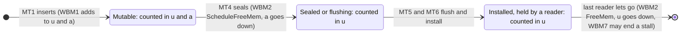

# The Write Buffer Manager

## Reference

- [RocksDB wiki: Write Buffer Manager](https://github.com/facebook/rocksdb/wiki/Write-Buffer-Manager)

## Problem
Each column family in an LSM store keeps its recent writes in a memtable, a sorted buffer in memory. A memtable is capped by `write_buffer_size`. When full, it is sealed (read-only), replaced by a fresh one, and later flushed to an SST file in level 0. Its memory is freed once the SST is installed and no reader uses it. This cap is per memtable. 

The Write Buffer Manager (WBM) caps the total. One WBM is shared by every column family of one or more stores. It counts all their memtable memory and:

(a) asks for an early flush when the mutable memtables use too much;
(b) stalls every writer, if stalls are allowed, when the total reaches the limit;
(c) can charge memtable memory to the block cache, so both share one budget.

## How It Fits with the WAL and the Memtables

WBM does not store data or run flushes. It sits beside the write path and keeps two byte counts: the memory of all memtables not yet freed, and the part of it held by memtables that still take writes. It answers questions from these counts. Four parts of the RocksDB store talk to it:

**The write-ahead log (WAL).** Every write is logged before it reaches a memtable. Before the WAL takes in a group of writes, it asks WBM two questions. Is memtable memory too high, so that one should be flushed early (`ShouldFlush`, WBM4)? Is total memory at the limit, so that writers should wait (`StallState`, WBM5)? If WBM says flush, the WAL picks a column family, seals its memtable, and requests a flush, exactly as it does when a memtable fills up on its own. If WBM says wait, the writers pause until WBM lets them go.

**The memtables.** A memtable reports its memory to WBM over its life. When it grows, it tells WBM how much. When it is sealed, it tells WBM it no longer takes writes. When it is finally destroyed, it tells WBM its memory is gone.

**Flush and readers.** A flush writes a sealed memtable to an SST file. The memtable is destroyed only after that SST is installed and the last reader lets go of it. Only then does WBM see memory go down, and only then can a stall end.

**The block cache.** If WBM is set to charge the cache, it puts placeholder entries there as memtable memory grows and removes them as it shrinks, so the cache has less room for file blocks.

Connecting this to other specs, the WAL asks its questions in WAL1 (Admit), seals in WAL6a, and requests the flush in WAL6b. A memtable grows in MT1, is sealed in MT4, and its SST is installed in MT6.

The memtable's three reports are contracts K5 to K7. They extend the WAL's contracts K1 to K4:

- **(K5)** Every byte a memtable allocates is charged to WBM before the insert returns.
- **(K6)** MT4 tells WBM about the seal in the same step as the seal.
- **(K7)** WBM is told that a memtable is freed exactly once, when the memtable is destroyed.

## State

WBM keeps two byte counts, two limits, and the state of a stall:

- **u** (`memory_used_`) counts every memtable not yet freed. **a** (`memory_active_`) counts only
  the mutable ones, so a ≤ u.
- **β** is `buffer_size`. WBM is on when β > 0. The mutable limit **λ** is 7/8 of β.
- **s** says whether a stall is on. **Q** is the queue of stores whose writers wait.
- **r** is the memory WBM holds in the block cache, in empty 256 KB "dummy" entries.
- Two options shape the rules: `allow_stall`, and the flush policy (FlushOldest by default,
  FlushLargest, or FlushLargestAcrossDBs).

WBM keeps only totals, not a list of memtables. So each memtable keeps its own share: the bytes it has added to u and a so far. When the memtable is sealed, WBM subtracts that number from a. When it is destroyed, WBM subtracts it from u. The memtable also keeps two flags, "seal reported" and "free reported", so that neither subtraction happens twice. (see [WBMaccounting.pdf](diagrams/WBMaccounting.pdf))

## Lifecycle

The two counters in WBM do different jobs. **a** says how much memory a flush request could still free, because only a mutable memtable can be sealed. **u** says how much memory is really in use, including memtables that are being flushed or that a reader still holds. 

## When WBM Asks for a Flush

WAL1 calls `ShouldFlush` (WBM4) before each write group. It returns true in two cases:

1. **a > λ**: the mutable memtables use more than 7/8 of the limit.
2. **u ≥ β and a ≥ β/2**: all memtables are at the limit, and at least half of the memory can
   still be flushed. If more than half is already sealed, it is already being flushed, and sealing
   one more small memtable would only add a small L0 file.

If it returns true, WAL1 asks `PickVictims` (WBM4) for one column family. It skips empty memtables and
column families whose flush is already pending. Then it picks by policy: the column family whose
memtable was **created first** (FlushOldest, the default), or the one with the **largest** memtable.
At most one memtable is sealed for memory per write group.

The wiki says the flush starts at "about 90%" of the limit. The source uses 7/8, and this design
follows the source.

## Stalls

With `allow_stall`, `StallState` (WBM5) returns Stop when **u ≥ β**, and the writer stops. Once one writer has stopped, every new writer
stops too (s is on), until memory goes down.

Three details matter. The writer tests again under the mutex (WBM6), because memory may have gone
down between its first test and joining the queue. Every free and every change of the limit runs
WBM7, because either one can end a stall. And WBM7 wakes every waiting store, not just the first.

A woken writer does not test again. So the limit is **soft**: memory can go past it.

## Charging the Block Cache

If a block cache is given to WBM, WBM inserts empty dummy entries of 256 KB into it, enough to cover u.
The cache then evicts real blocks to make room, so memtables and cached blocks share one budget.
The reservation **grows at once and shrinks late**. When u falls, WBM keeps the entries unless u is
below 3/4 of what it holds. Then it releases entries, down to the fewest that still cover u. It does
this because inserting entries is costly, and memory that just went down tends to come back.

## Algorithms

All of them are in [WBM_algorithms_all.pdf](WBM_algorithms_all.pdf) (source: [WBM_algorithms_all.tex](WBM_algorithms_all.tex)). The first page follows memtable memory end to end and links to each algorithm.

| Algorithm | Procedure | What it does |
|---|---|---|
| WBM1 | `ReserveMem(M, m)` | Charges new memtable memory to u and a (called by MT1) |
| WBM2 | `ScheduleFreeMem(M)`, `FreeMem(M)` | Takes a sealed memtable out of a; takes a destroyed one out of u |
| WBM3 | `UpdateCacheReservation(x)` | Grows or shrinks the dummy entries in the block cache |
| WBM4 | `ShouldFlush()`, `PickVictims(T)` | Decides whether to flush for memory, and which column family |
| WBM5 | `StallState()`, `StallWrites(G)` | Says Stop or Go; the store side of a stall (RocksDB calls the test `ShouldStall`) |
| WBM6 | `BeginWriteStall(x)` | Tests again under the mutex and queues the store |
| WBM7 | `MaybeEndWriteStall()` | Ends the stall and wakes every queued store when u < β |
| WBM8 | `SetBufferSize`, `SetAllowStall`, `RemoveDBFromQueue` | Changes options at run time; takes a closing store out of the queue |
| WBM9 | `FlushAcrossDBs(d)` | With FlushLargestAcrossDBs, flushes some store's largest memtable while a writer is stalled |

## Invariants

- **BM1, exact accounting.** u is the sum of the shares of every memtable not yet freed, and a is the sum of the shares of the mutable ones.
- **BM2, no lost wake-up.** While a store's writer waits, the stall is on and the store is in Q, so the next WBM7 that ends the stall signals it.
- **BM3, bounded memory.** With stalls on and a test under the mutex, u goes past β by less than one write group per store.
- **BM4, cache coverage.** When WBM charges a block cache, r covers u in whole dummy entries.
- **BM5, consistent queue.** Q holds exactly the stores whose writers wait, and is empty when no stall is on.
- **BM6, writes finish.** Every write that enters WAL1 eventually leaves it, as long as flushes, installs and readers make progress.

BM1, BM2 and BM6 matter for compaction: they decide when memtables are flushed, and so which L0 files compaction gets, or whether writes keep coming at all. RocksDB keeps BM1, BM2 and BM5. It breaks BM3 (its limit is soft), BM4 (with a strict cache), and BM6 (with the default flush policies); see Findings.

## Findings

**A stalled writer can wait forever with the default policy.** With FlushOldest or FlushLargest,
only WAL1 of a store that is being written asks for a memory flush, and a waiting writer does not
run WAL1 again. TLC finds four ways in which the memory that keeps u ≥ β sits in mutable memtables
that nobody will flush:

- Another store that shares WBM holds the memory, and has no writers.
- One memtable alone reaches the limit, because `write_buffer_size` is above `buffer_size`.
- `SetBufferSize` lowered the limit below what one memtable holds.
- In one store with ordinary sizes, a late WBM7 lets a write in over the limit (the soft stall
  below) while every column family already has a flush pending. The next WAL1 finds nothing to
  flush, and stalls.

We believe RocksDB behaves the same way. Its newer FlushLargestAcrossDBs policy, where a waiting
writer retries every 20 ms, removes all four.

**The limit is soft.** WBM7 tests u < β before it takes the mutex and does not test again. A call
that was delayed can end a stall that a later write has started again, and the writer it wakes goes
on. RocksDB calls the stall a soft limit.

**A strict cache can leave memory uncharged.** If the block cache has a strict capacity limit and is
full, a dummy entry insert fails. RocksDB ignores the error, and r stays below u.

## Document underspecification in the Wiki:

(a) **Which column family is flushed.** The wiki says a flush "will be triggered on one column family of the DB you are inserting to", but never says which one. WBM4 (`PickVictims`) skips empty memtables and column families whose flush is already pending or running, then picks the oldest mutable memtable (FlushOldest, the default) or the largest. Without this rule, an early flush can pick a column family that frees nothing, so the trigger fires again on every write group, and the choice also decides which L0 files compaction gets.

(b) **The exact flush thresholds.** The wiki says a flush starts at "about 90%" of the limit, and above the limit only if mutable memory is over 50%. WBM4 uses the source's exact rule: a > 7β/8, or u ≥ β and a ≥ β/2. A model built on 90% flushes later than RocksDB does, and so predicts larger memtables and fewer, bigger L0 files.

(c) **When memtable memory counts as freed.** The wiki says memory is counted as arena allocation, but never says when it stops counting: at the seal, at the flush, or when the last reader lets go. WBM2 takes a memtable's share out of a when it is sealed (`ScheduleFreeMem`), and out of u only when it is destroyed (`FreeMem`), once each. If u drops at the seal, memory goes past the limit without a stall; if a never drops, `ShouldFlush` stays true and every write group seals another small memtable (TLC catches both, BM1).

(d) **When a stall ends, and who is woken.** The wiki says stalled writers "wait for flush to complete and memory usage to drop down", but not which event checks this or how many writers are woken. WBM6 tests again under the mutex before queuing, and WBM7 runs on every free and every change of the limit, and wakes every queued store. Without the second test or the wake-all, a writer can wait for a signal that never comes, and its store stops writing for good (TLC catches both, BM2).

(e) **Who flushes while writers are stalled.** The wiki says a stalled writer waits for a flush, but never says who starts it when the memory sits in another store, or in one memtable bigger than the limit. WBM9 (FlushLargestAcrossDBs) hands the flush to the store with the most flushable memory, and the stalled writer retries a local flush every 20 ms. With the default policies nobody flushes that memory, and the stall lasts forever (TLC finds four ways, BM6).

(f) **How soft the limit is.** The wiki calls `buffer_size` a "soft limit" when stalls are on, but never says how far memory can go past it. WBM5 lets a woken group go ahead without testing again, and WBM7 tests u < β before it takes the mutex. So u can exceed β by about one write group per store, and by more after a late WBM7, and a model that assumes u ≤ β is wrong (TLC, BM3).

(g) **The dummy entry size and how far it shrinks.** The wiki says the cache gets "dummy 1MB entries" and shrinks when usage is under 3/4 of the reservation, but not by how much. WBM3 uses 256 KB entries and shrinks down to the fewest entries that still cover u. With the wrong size or shrink rule, a model charges the cache in different steps, and evicts different data blocks than RocksDB. *(unchecked)*

(h) **A strict block cache.** The wiki never mentions a cache with `strict_capacity_limit`. WBM3 returns the failed insert, and WBM1 and WBM2 ignore it, so r can stay below u. Then memtables use memory the cache does not know about, and memtables plus cache go over the budget the user set (TLC, BM4). *(unchecked)*

(i) **Changes while running.** The wiki never mentions `SetBufferSize`, `SetAllowStall`, or a store closing while others share WBM. WBM8 runs WBM7 after each change, and takes a closing store out of the queue and signals it. Without this, raising the limit or turning stalls off leaves writers waiting, and a closed store stays in Q (TLC catches the first, BM2).

The items marked *(unchecked)* rest on what we know of the RocksDB code and should be checked against its source.
