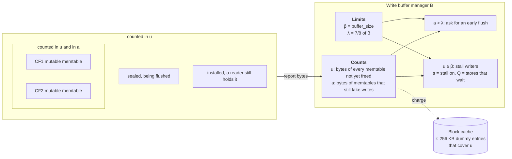
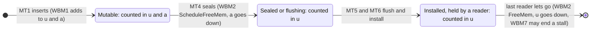
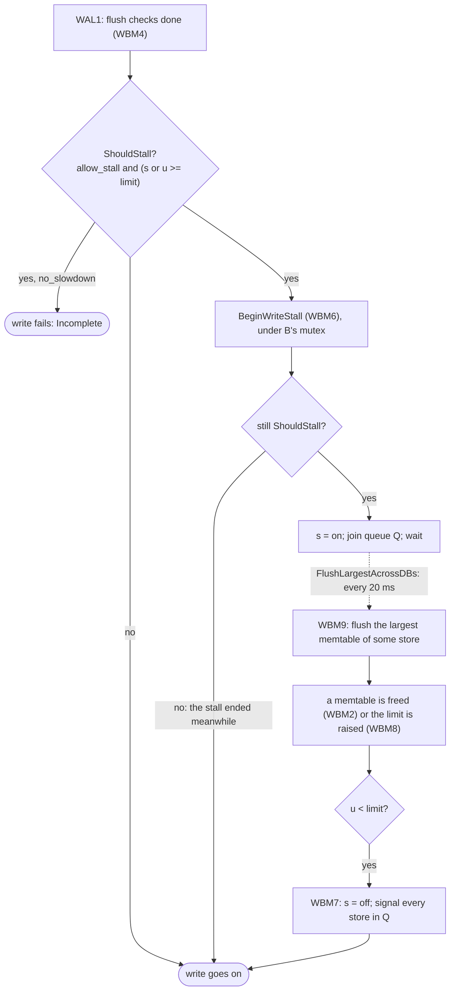

# The Write Buffer Manager

## Reference

- [RocksDB wiki: Write Buffer Manager](https://github.com/facebook/rocksdb/wiki/Write-Buffer-Manager)

# Problem
Each column family in an LSM store keeps its recent writes in a memtable, a sorted buffer in memory. A memtable is capped by write_buffer_size. When full, it is sealed (read-only), replaced by a fresh one, and later flushed to an SST file in level 0. Its memory is freed once the SST is installed and no reader uses it. This cap is per memtable. 

The Write Buffer Manager (WBM) caps the total. One WBM is shared by every column family of one or more stores. It counts all their memtable memory and:

(a) asks for an early flush when the mutable memtables use too much;
(b) stalls every writer, if stalls are allowed, when the total reaches the limit;
(c) can charge memtable memory to the block cache, so both share one budget.

# How it fits with WAL and memtables

WBM does not store data or run flushes. It sits beside the write path and keeps two byte counts: the memory of all memtables not yet freed, and the part of it held by memtables that still take writes. It answers questions from these counts. Four parts of the RocksDB store talk to it:

The write-ahead log (WAL) : Every write is logged before it reaches a memtable. Before the WAL takes in a group of writes, it asks WBM two questions. Is memtable memory too high, so that one should be flushed early? Is total memory at the limit, so that writers should wait? If WBM says flush, the WAL picks a column family, seals its memtable, and requests a flush, exactly as it does when a memtable fills up on its own. If WBM says wait, the writers pause until WBM lets them go.

The memtables: A memtable reports its memory to WBM over its life. When it grows, it tells WBM how much. When it is sealed, it tells WBM it no longer takes writes. When it is finally destroyed, it tells WBM its memory is gone.

Flush and readers: A flush writes a sealed memtable to an SST file. The memtable is destroyed only after that SST is installed and the last reader lets go of it. Only then does WBM see memory go down, and only then can a stall end.

The block cache: If WBM is set to charge the cache, it puts placeholder entries there as memtable memory grows and removes them as it shrinks, so the cache has less room for file blocks.

Connecting this to other specs, the WAL asks its questions in WAL1 (Admit), seals in WAL6a, and requests the flush in WAL6b. A memtable grows in MT1, is sealed in MT4, and its SST is installed in MT6.

The memtable's three reports are contracts K5 to K7. They extend the WAL's contracts K1 to K4:

(K5) Every byte a memtable allocates is charged to WBM before the insert returns.
(K6) MT4 tells WBM about the seal in the same step as the seal.
(K7) WBM is told that a memtable is freed exactly once, when the memtable is destroyed.

## State

WBM keeps two byte counts, two limits, and the state of a stall:

- **u** (`memory_used_`) counts every memtable not yet freed. **a** (`memory_active_`) counts only
  the mutable ones, so a ≤ u.
- **β** is `buffer_size`. WBM is on when β > 0. The mutable limit **λ** is 7/8 of β.
- **s** says whether a stall is on. **Q** is the queue of stores whose writers wait.
- **r** is the memory WBM holds in the block cache, in empty 256 KB "dummy" entries.
- Two options shape the rules: `allow_stall`, and the flush policy (FlushOldest by default,
  FlushLargest, or FlushLargestAcrossDBs).

WBM keeps only totals, not a list of memtables. So each memtable keeps its own share: the bytes it has added to u and a so far. When the memtable is sealed, B subtracts that number from a. When it is destroyed, B subtracts it from u. The memtable also keeps two flags, "seal reported" and "free reported", so that neither subtraction happens twice. (see WBMaacounting.pdf)

## Lifecycle

The two counters in WBM do different jobs. `a` says how much memory a flush request could still free as only a mutable memtable can be sealed. u says how much memory is really in use, including memtables that are being flushed or that a reader still holds. 

## When WBM Asks for a Flush

WAL1 calls `ShouldFlush` before each write group. It returns true in two cases:

1. **a > λ**: the mutable memtables use more than 7/8 of the limit.
2. **u ≥ β and a ≥ β/2**: all memtables are at the limit, and at least half of the memory can
   still be flushed. If more than half is already sealed, it is already being flushed, and sealing
   one more small memtable would only add a small L0 file.

If it returns true, WAL1 asks `PickVictims` for one column family. It skips empty memtables and
column families whose flush is already pending. Then it picks by policy: the column family whose
memtable was **created first** (FlushOldest, the default), or the one with the **largest** memtable.
At most one memtable is sealed for memory per write group.

The wiki says the flush starts at "about 90%" of the limit. The source uses 7/8, and this design
follows the source.

## Stalls

With `allow_stall`, a writer stops when **u ≥ β**. Once one writer has stopped, every new writer
stops too (s is on), until memory goes down.

Three details matter. The writer tests again under the mutex (WBM6), because memory may have gone
down between its first test and joining the queue. Every free and every change of the limit runs
WBM7, because either one can end a stall. And WBM7 wakes every waiting store, not just the first.

A woken writer does not test again. So the limit is **soft**: memory can go past it.

## Charging the Block Cache

If a block cache is given to B, B inserts empty dummy entries of 256 KB into it, enough to cover u.
The cache then evicts real blocks to make room, so memtables and cached blocks share one budget.
The reservation **grows at once and shrinks late**. When u falls, B keeps the entries unless u is
below 3/4 of what it holds. Then it releases entries, down to the fewest that still cover u. It does
this because inserting entries is costly, and memory that just went down tends to come back.

## Algorithms

| Algorithm | Procedure | What it does |
|---|---|---|
| WBM1 | `B.ReserveMem(M, m)` | Charges new memtable memory to u and a (called by MT1) |
| WBM2 | `B.ScheduleFreeMem(M)`, `B.FreeMem(M)` | Takes a sealed memtable out of a; takes a destroyed one out of u |
| WBM3 | `B.UpdateCacheReservation(x)` | Grows or shrinks the dummy entries in the block cache |
| WBM4 | `B.ShouldFlush()`, `B.PickVictims(T)` | Decides whether to flush for memory, and which column family |
| WBM5 | `B.ShouldStall()`, `StallWrites(G)` | Decides whether writers stall; the store side of a stall |
| WBM6 | `B.BeginWriteStall(x)` | Tests again under the mutex and queues the store |
| WBM7 | `B.MaybeEndWriteStall()` | Ends the stall and wakes every queued store when u < β |
| WBM8 | `SetBufferSize`, `SetAllowStall`, `RemoveDBFromQueue` | Changes options at run time; takes a closing store out of the queue |
| WBM9 | `B.FlushAcrossDBs()` | With FlushLargestAcrossDBs, flushes some store's largest memtable while a writer is stalled |

## Invariants

Three properties matter for flushes and compaction. Each one shapes when memtables are flushed, and
so the L0 files compaction receives, or whether writes keep coming at all.

- **BM1, exact accounting.** u equals the memory of every memtable that still exists, and a equals
  the memory of the mutable ones. The flush trigger and the stall read only these two counters. If a
  stayed high after a seal, `ShouldFlush` would keep saying yes and every write would seal another
  memtable, so L0 would fill with small files and compaction would have more, smaller inputs. If u
  dropped too early, memory would go past the limit without a stall. Keeping BM1 costs nothing at
  run time: MT4 and the memtable's destructor each make one call.
- **BM2, no lost wake-up.** A writer waits only while u ≥ β, or while a call that will wake it is
  still running. A lost wake-up stops a store's writes for good, and with them the flushes that
  feed compaction. Keeping it costs one more test under B's mutex.
- **BM6, writes finish.** Every write that enters WAL1 eventually leaves it, if flushes, installs,
  and readers make progress. This holds only with FlushLargestAcrossDBs (see Findings). When it fails,
  writes stop while memtables that nobody flushes hold the memory.

The other three properties do not change which memtables are flushed or when. With stalls on and a
test under the mutex, memory goes past the limit by less than one write per store (BM3, bounded
overshoot); RocksDB does not have that test, so its limit is soft. The dummy entries cover u, in
whole entries, and are at most about a third too many (BM4, cache coverage). The queue holds exactly
the waiting stores, and is empty when no stall is on (BM5, consistent queue).

## Findings

**A stalled writer can wait forever with the default policy.** With FlushOldest or FlushLargest,
only WAL1 of a store that is being written asks for a memory flush, and a waiting writer does not
run WAL1 again. TLC finds four ways in which the memory that keeps u ≥ β sits in mutable memtables
that nobody will flush:

- Another store that shares B holds the memory, and has no writers.
- One memtable alone reaches the limit, because `write_buffer_size` is above `buffer_size`.
- `SetBufferSize` lowered the limit below what one memtable holds.
- In one store with ordinary sizes, a late WBM7 lets a write in over the limit (the soft stall
  below) while every column family already has a flush pending. The next WAL1 finds nothing to
  flush, and stalls.

We believe RocksDB behaves the same way. Its newer FlushLargestAcrossDBs policy, where a waiting
writer retries every 20 ms, removes all four.

**The limit is soft.** WBM7 tests u < β before it takes the mutex and does not test again. A call
that was delayed can end a stall that a later write has started again, and the writer it wakes goes
on. RocksDB calls the stall a soft limit.

**A strict cache can leave memory uncharged.** If the block cache has a strict capacity limit and is
full, a dummy entry insert fails. RocksDB ignores the error, and r stays below u.